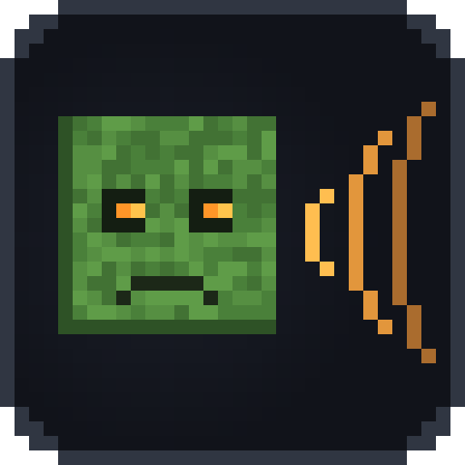

<h1 align="center">Mob Senses</h1>

<b>English</b> · <a href="README.ru.md">Русский</a>

Mobs hear you, see your light and, with Simple Voice Chat, hear your voice. A server-side survival and stealth mod for Fabric, Forge, NeoForge and Paper.

> **Early development.** This is the first build: the mod loads on every supported server, hears the game's noise and has its commands and settings, but mobs do not react to noise yet. That comes in 0.1.0 (see [Plans](#plans)). Screenshots and store pages come with it.

Hostile mobs in vanilla notice you only within a fixed range. With Mob Senses they also use their senses:

- **Hearing.** Running is loud, sneaking is quiet, wool muffles your steps and gravel gives you away. Breaking and placing blocks, doors, chests, fights, arrows, explosions, bells and note blocks make noise too. A mob that hears it walks to **where the noise came from**, looks around and goes back to its business. Stone walls muffle noise, glass and wood less, an open door lets it through.
- **Voice** (with [Simple Voice Chat](https://modrinth.com/plugin/simple-voice-chat)). Mobs hear you talk. A shout carries far, a whisper only next to them; loudness is measured against each player's own normal voice, so a quiet microphone gives no free stealth.
- **Light and stealth.** A torch in your hand makes you visible from afar, darkness and sneaking hide you.
- **Scent.** A badly wounded player leaves a trail that zombies and spiders follow.

It works like Zombie Awareness, for current Minecraft versions and on Forge, NeoForge, Fabric and Paper, with walls and voice chat taken into account.

## Contents

- [Quick start](#quick-start)
- [What works where](#what-works-where)
- [Versions and files](#versions-and-files)
- [Commands](#commands)
- [Settings file](#settings-file)
- [Compatibility](#compatibility)
- [Plans](#plans)
- [Questions and problems](#questions-and-problems)
- [Building](#building)

## Quick start

**Server**
1. Fabric, Quilt, Forge or NeoForge: put the mod's `.jar` into `mods/` (on Fabric and Quilt also [Fabric API](https://modrinth.com/mod/fabric-api)). Paper, Purpur, Folia or Spigot: put `mob-senses-bukkit-*.jar` into `plugins/`.
2. Start the server. Players join with any client, vanilla too: they need nothing.
3. Choose how keen the senses are with `/mobsenses preset subtle|default|hardcore`, or in the [settings file](#settings-file).

**Singleplayer**: put the same `.jar` into `.minecraft/mods/`. The world's own server runs it.

[Simple Voice Chat](https://modrinth.com/plugin/simple-voice-chat) is optional: without it everything but the voice works.

## What works where

| | Server with the mod | Server without the mod |
|---|---|---|
| **Player without the mod** (vanilla client) | Everything: mobs hear, see and smell | Vanilla |
| **Player with the mod** | Everything, plus the noise and stealth HUD *(planned)* | Vanilla; the HUD shows "no data" *(planned)* |
| **Singleplayer** | Everything | — |

The senses live on the server. The client part will only draw the HUD.

## Versions and files

| You run | Minecraft | File |
|---|---|---|
| **Fabric, Quilt** | 1.21 – 1.21.11, 26.1 – 26.3 | `mob-senses-fabric-…+mc1.21-26.x.jar` + [Fabric API](https://modrinth.com/mod/fabric-api) |
| **Forge** | 1.20 – 1.20.1 | `mob-senses-forge-neoforge-…+mc1.20.1-1.21.1.jar` |
| **NeoForge** | 1.20.1, 1.21 – 1.21.1 | the same file |
| **Paper, Purpur, Folia, Spigot** | 1.16.5 – 26.3 | `mob-senses-bukkit-….jar` |

One file serves every Minecraft version of its loader: it picks the right code when the game starts. More versions (1.16.5 – 1.20.6 on the mod loaders, Forge and NeoForge 1.21.2+ and 26.x) come in later releases; the badge above shows where the project is headed.

Java: what your Minecraft version needs (17 for 1.20.1, 21 for 1.21, 25 for 26.x; the plugin runs on Java 8 and newer).

## Commands

`/mobsenses` is for operators (level 2) and the console. On Paper the permission is `mobsenses.admin` (operators by default). Replies come in the player's language.

| Command | What it does |
|---|---|
| `/mobsenses` or `/mobsenses status` | Version, preset, multipliers, voice chat, how much noise the server heard in the last minute |
| `/mobsenses preset <off\|subtle\|default\|hardcore>` | How keen the senses are; `off` makes mobs behave as in vanilla |
| `/mobsenses hearing <0-3>` | How far mobs hear, times the preset |
| `/mobsenses sight <0-3>` | How far mobs see you, times the preset |
| `/mobsenses voice <on\|off>` | Whether mobs hear Simple Voice Chat |
| `/mobsenses world <world\|here> <preset\|inherit>` | A world's own preset (`inherit`: back to the server's) |
| `/mobsenses reload` | Read the settings file again |
| `/mobsenses help` | The list of commands |

| Preset | Hearing | Sight | For |
|---|---|---|---|
| Off | — | — | Vanilla mobs |
| Subtle | ×0.6 | ×0.8 | Builders' servers: mobs notice only real noise |
| Default | ×1 | ×1 | Survival |
| Hardcore | ×1.6 | ×1.3 | Horror and hardcore: every step counts |

## Settings file

`config/mobsenses-server.properties` (Fabric, Forge, NeoForge) or `plugins/MobSenses/mobsenses-server.properties` (Paper). It is written with comments on the first start and read again when you save it, without a restart.

| Key | Default | Meaning |
|---|---|---|
| `preset` | `default` | `off`, `subtle`, `default` or `hardcore` |
| `hearing` | `1` | How far mobs hear, times the preset (0 – 3) |
| `sight` | `1` | How far mobs see the player, times the preset (0 – 3) |
| `voice` | `true` | Whether mobs hear players in Simple Voice Chat |
| `language` | `en_us` | Language of replies to the console and to players whose language is unknown |
| `world.<id>.preset` | — | A world's own preset. On the mod loaders the id is the dimension (`world.minecraft\:the_nether.preset=off`, the colon written as `\:`), on Paper the world's folder (`world.world_nether.preset=off`) |

## Compatibility

- **Vanilla clients** join a server with the mod; the mod does not change the network protocol.
- **Other AI mods** (In Control!, Enhanced AI, Improved Mobs and the like): Mob Senses adds its own low-priority behaviour and leaves the mobs' other goals alone. Compatibility is checked as the senses arrive.
- **Simple Voice Chat**: optional; without it everything but the voice works.

## Plans

| Version | What comes |
|---|---|
| 0.1.0 | Hearing: steps, blocks, doors, fights, explosions; mobs walk to the noise; walls muffle it; presets per world |
| next | Voice through Simple Voice Chat, measured against each player's own normal voice |
| next | The HUD: how loud and how visible you are, who heard you and from where |
| next | Light and stealth; then scent and blood trails; then the wider version range |

## Questions and problems

- **Mobs do not react.** This build only counts noise; reactions come in 0.1.0. `/mobsenses status` shows how much noise the server hears.
- **A bug or an idea?** [Open an issue](https://github.com/Shamanalle/mob-senses/issues).

## Building

JDK 25 (and a JDK 17 for the Java 8 parts, found by Gradle's toolchains): `./gradlew build` puts the three release files into `build/libs/`. [CONTRIBUTING.md](CONTRIBUTING.md) explains where the code lives and how it is tested.

## License

[MIT](LICENSE).
