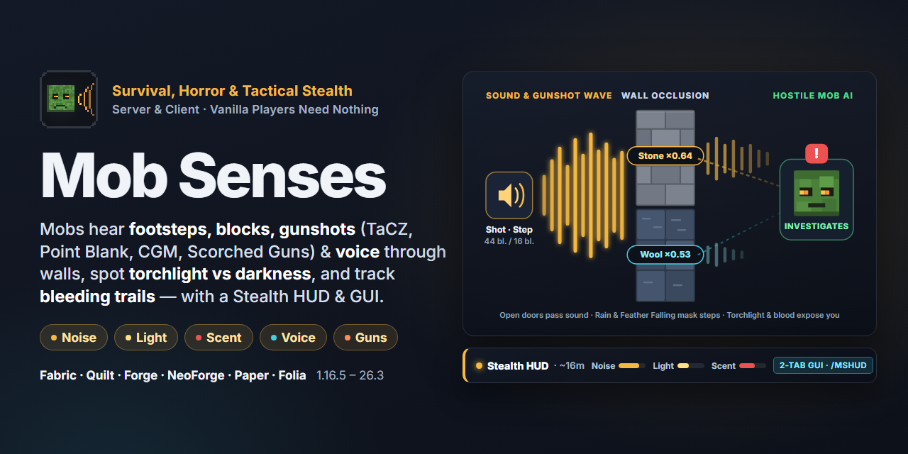
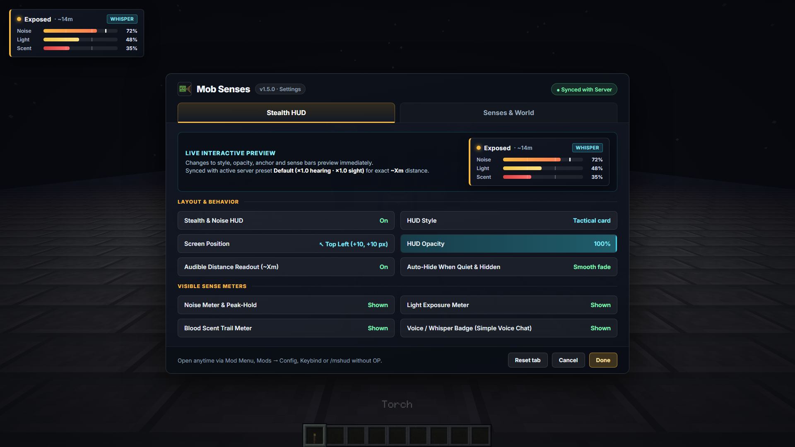
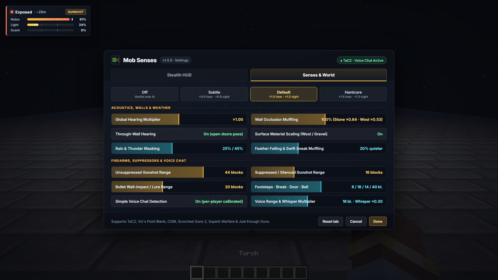
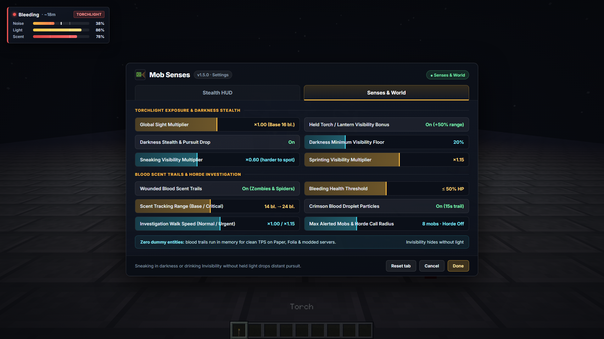
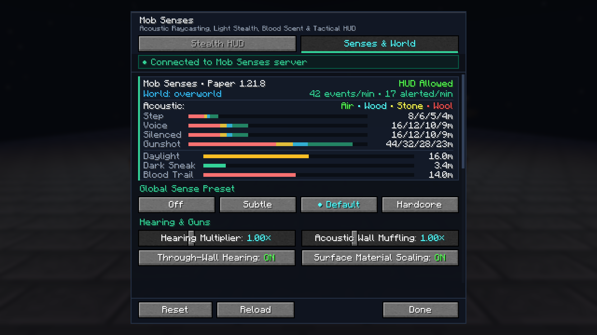
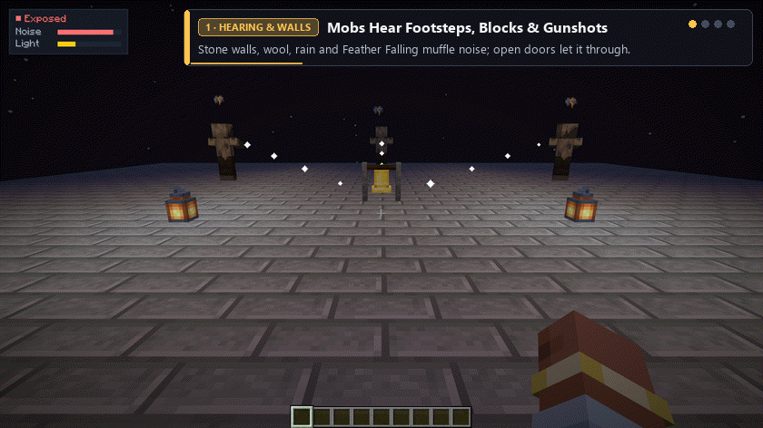
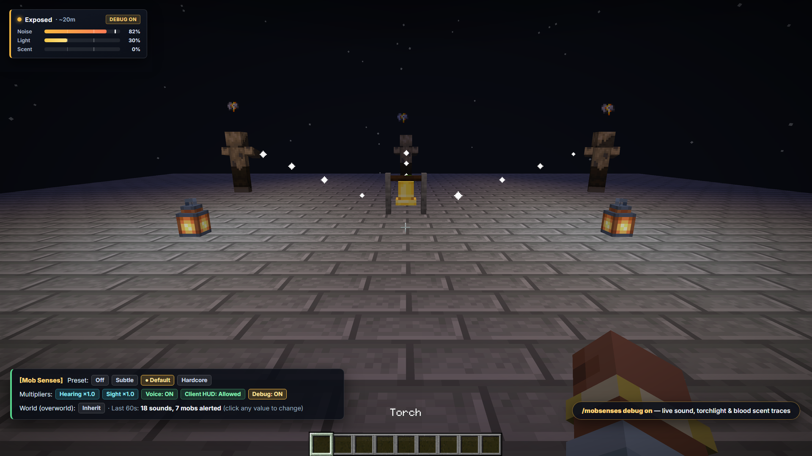

<b>English</b> · <a href="README.ru.md">Русский</a>

Mobs hear footsteps, blocks, gunshots (with suppressors!) and <a href="https://modrinth.com/plugin/simple-voice-chat">Simple Voice Chat</a> through walls, spot held torchlight vs darkness, and track bleeding trails — with a Tactical Stealth HUD and sleek 2-tab settings GUI for Fabric, Quilt, Forge, NeoForge, Paper and Folia.

| Stealth HUD & Live Preview | Acoustics, Firearms & Voice |
|---|---|
|  |  |

| Torchlight, Darkness & Blood Scent | Live Server Sync & Dimensions |
|---|---|
|  |  |

Hostile mobs in vanilla notice you only within a fixed radius. With **Mob Senses**, they use their senses:

- **Hearing & wall occlusion.** Sprinting is loud, sneaking is quiet, wool and carpet muffle your steps while gravel and metal give you away. Breaking and placing blocks, doors, chests, fights, arrows, gunshots, explosions, bells, note blocks and eating make noise too. A mob that hears noise walks to **where the sound came from**, searches the spot and goes back to its business. Stone walls (`×0.64`), wool (`×0.53`), rain, thunderstorms, *Feather Falling* boots and *Swift Sneak* leggings muffle noise, glass and wood less, and an open door lets it through.
- **Firearms & suppressors.** Native support for **TaCZ**, **Vic's Point Blank**, **MrCrayfish's Gun Mod**, **Scorched Guns 2**, **Superb Warfare** and **Just Enough Guns**: unsuppressed gunshots carry far (`44` blocks), silencers and suppressors muffle shots to close range (`16` blocks), and distant bullet wall impacts (`20` blocks) draw mobs to the impact spot so you can lure hordes away.
- **Voice** *(with [Simple Voice Chat](https://modrinth.com/plugin/simple-voice-chat))*. Mobs hear you talk. A shout carries far, a whisper only next to them; loudness is calibrated automatically against each player's own normal speaking voice, so a quiet microphone gives no free stealth.
- **Light, darkness stealth & blood scent.** A torch or lantern in your hand makes you visible from afar (`+50%`), while darkness, sneaking and invisibility potions hide you and drop distant pursuit. A badly wounded player (at or below half health) leaves a blood trail with crimson droplets that zombies and spiders follow — with zero dummy entities spawned in the world.
- **Stealth HUD & sleek 2-tab GUI.** Players with the client mod get a customizable Stealth & Noise HUD and a 2-tab dark-slate settings screen (*Stealth HUD* with live interactive preview + *Senses & World*), synced automatically with modded and Paper/Folia servers — while **vanilla clients join with nothing installed**.

**A next-generation alternative to Zombie Awareness** — built with real wall occlusion, firearm and suppressor acoustics, **Simple Voice Chat** detection, darkness stealth, a client Stealth HUD & 2-tab GUI, and **zero library dependencies** (no CoroUtil needed) in three universal files covering **Minecraft 1.16.5 – 26.3** across **Fabric, Quilt, Forge, NeoForge, Paper and Folia**.

## Contents

- [Quick start](#quick-start)
- [How mobs sense you](#how-mobs-sense-you)
- [For players](#for-players)
- [For servers](#for-servers)
- [What works where](#what-works-where)
- [Versions and files](#versions-and-files)
- [Commands and permissions](#commands-and-permissions)
- [Settings files](#settings-files)
- [Compatibility](#compatibility)
- [Questions and problems](#questions-and-problems)
- [Building](#building)

## Quick start

**Which file:** One universal `.jar` covers Fabric and Quilt (`1.16.5 – 26.3`), one universal `.jar` covers Forge (`1.16.5 – 26.3`) and NeoForge (`1.20.1 – 26.3`), and one universal plugin `.jar` covers Paper, Purpur, Folia, Spigot and Bukkit (`1.16.5 – 26.3`). Exact file names and Java versions are in [Versions and files](#versions-and-files).

**Server**
1. Fabric, Quilt, Forge or NeoForge: put the mod's `.jar` into `mods/` (on Fabric and Quilt also install [Fabric API](https://modrinth.com/mod/fabric-api)). Paper, Purpur, Folia or Spigot: put `mob-senses-bukkit-*.jar` into `plugins/`.
2. Start the server. Players join with any client, **vanilla clients included** — they need nothing installed.
3. Choose how keen the senses are with `/mobsenses preset subtle|default|hardcore`, on the **Senses & World** tab of the in-game settings screen, or in [`mobsenses-server.properties`](#server-file).

**Player & Singleplayer**
1. Put the mod's `.jar` into `.minecraft/mods/` (plus [Fabric API](https://modrinth.com/mod/fabric-api) on Fabric/Quilt; [Mod Menu](https://modrinth.com/mod/modmenu) is optional).
2. In singleplayer the integrated server runs all mob senses automatically. On multiplayer servers you get the **Stealth HUD** and **2-tab Settings GUI**.
3. Open settings anytime from **Mod Menu** (Fabric/Quilt), **Mods → Config** (Forge/NeoForge), your own keybind (*Mob Senses…* in *Controls*), or `/mshud`.

[Simple Voice Chat](https://modrinth.com/plugin/simple-voice-chat) is optional: without it everything except voice detection works.

## How mobs sense you

### Hearing & wall occlusion
- **Movement & surfaces:** walking carries `8` blocks by default, sprinting `×1.75` farther and sneaking `×0.25`. Walking on wool or carpet muffles footsteps, while gravel, metal and amethyst give you away. *Feather Falling* boots and *Swift Sneak* leggings reduce footstep noise by `20%`.
- **World actions:** breaking (`18` blocks) and placing (`12` blocks) blocks, opening doors/trapdoors/fence gates (`14`), chests/barrels/shulker boxes (`12`), melee combat (`16`), arrows & projectiles (`15`), explosions (`48`), bells (`40`), note blocks (`28`) and eating/drinking (`8`) each emit sound with customizable ranges.
- **Acoustic raycasting through walls:** every sound traces blocks between you and each listener mob. Solid stone/brick walls cut range (`×0.64` per block) and wool muffles even more (`×0.53`), wood and glass block less, and open doors, open trapdoors and open fence gates let sound pass freely. Rain (`25%`) and thunderstorms (`45%`) mask outdoor noise.
- **Investigation AI:** alerted mobs walk to **the exact spot where the sound came from**, search the area (`8 s` by default, moving faster for urgent sounds like gunshots, bells and explosions), and return to normal if you stay hidden. The goal yields immediately whenever a mob enters combat.

### Firearms, suppressors & bullet lures
- Native acoustics for **[TaCZ](https://modrinth.com/mod/timeless-and-classics-zero)** (*Timeless and Classics Zero*), **Vic's Point Blank**, **MrCrayfish's Gun Mod (CGM)**, **Scorched Guns 2**, **Superb Warfare** and **Just Enough Guns**.
- **Unsuppressed shots** carry across the area (`44` blocks by default) and pull nearby mobs toward the shooter.
- **Suppressors & silencers** are detected directly on the weapon and cut gunshot noise down to close range (`16` blocks).
- **Tactical bullet wall-impact lures:** firing a silenced round into a distant wall creates noise where the bullet lands (`20` blocks), letting you distract or lure hordes away from a doorway.
- **Per-weapon tuning:** override any firearm by registry ID or keyword in `mobsenses-server.properties` (for example `gun.tacz\:ai_awp.range=85` or `gun.glock.silenced_range=8`).

### Proximity voice chat *(optional)*
- With [Simple Voice Chat](https://modrinth.com/plugin/simple-voice-chat) installed, speaking near hostile mobs draws their attention (`16` blocks for loud speech, `×0.3` when whispering).
- **Per-player auto-calibration:** loudness is measured against each player's own usual speaking level, so a quiet microphone gives no unfair stealth advantage while whispers stay quiet and shouts carry far.
- Works cleanly alongside [Sound Physics Remastered](https://modrinth.com/mod/sound-physics-remastered).

### Torchlight, darkness stealth & blood scent
- **Held light:** holding a torch, soul torch, lantern, glowstone, shroomlight or blaze rod increases how far mobs spot you (`+50%` by default).
- **Darkness stealth:** sneaking in low light or drinking an Invisibility potion (without holding a light source) shrinks mob sight distance down to `20%` and lets distant pursuers lose track of you.
- **Blood scent & horde alerts:** badly wounded players (`≤ 50%` health) leave a fast in-memory scent trail (`14–24` blocks for `15 s`) with subtle crimson blood droplets on the ground that zombies and spiders track, and alerted mobs can optionally rally nearby allies (`horde_alert_range`) — spawning **zero dummy marker entities** in the world.

## For players

- **Tactical & Minimal Stealth HUD:** switch between the chamfered **Tactical** card (dynamic stealth eye, `30%`/`65%` threshold ticks, transient peak-hold marker) and the slim **Minimal** bar strip. Displays live noise, estimated audible radius (`~Xm`), light exposure, blood scent, and `[Voice]` / `[Whisper]` badges, with smooth auto-hide fading when quiet.
- **Sleek 2-tab dark-slate Settings GUI:**
  - **Stealth HUD** — features a **live interactive HUD preview**, HUD visibility, *Tactical* / *Minimal* style, compact header mode, screen anchor, pixel offsets, opacity, audible `~Xm` readout, smooth auto-hide, and per-meter toggles.
  - **Senses & World** — presets (`Off`, `Subtle`, `Default`, `Hardcore`), hearing & wall-muffling sliders, firearm / suppressor / bullet-impact ranges, Simple Voice Chat toggles, torchlight & darkness stealth, blood trail & horde settings, per-dimension preset, and fair-play HUD rules (directly edits your integrated world in singleplayer, or syncs live when you have operator permissions on a multiplayer server).
- **Open it your way:** **Mod Menu** on Fabric/Quilt, **Mods → Config** on Forge/NeoForge, your own keybind (*Mob Senses…* in *Controls*), or `/mshud` (`/mobsenseshud`) on **any server without operator permissions**.
- **Seven languages:** English, Russian, Ukrainian, German, Spanish, Brazilian Portuguese and Chinese (Simplified).

## For servers

Available in the universal Fabric/Quilt and Forge/NeoForge mods and as a standalone server plugin (`mob-senses-bukkit-*.jar`) for **Paper, Purpur, Folia, Spigot and Bukkit**.

- **Vanilla clients welcome.** All mob hearing, sight, voice and blood-scent logic runs on the server; players without any mods get the full gameplay overhaul.
- **Four presets & per-dimension balance:**

  | Preset | Hearing | Sight | Best for |
  |---|---|---|---|
  | **Off** (`off`) | — | — | Vanilla mob behavior (safe dimensions, creative worlds) |
  | **Subtle** (`subtle`) | `×0.6` | `×0.8` | Builders' & casual survival servers: mobs react only to real noise |
  | **Default** (`default`) | `×1.0` | `×1.0` | Balanced survival & tactical modpacks |
  | **Hardcore** (`hardcore`) | `×1.6` | `×1.3` | Horror, zombie apocalypse & hardcore servers: every step counts |

  Set separate presets per dimension anytime with `/mobsenses world <world|here> <preset|inherit>`.
- **Lightweight client ↔ server sync (`mobsenses:*`) & fair play.** Modded clients joining a modded **or Paper/Purpur/Folia** server automatically sync the active server/dimension preset and multipliers so their `~Xm` HUD readout stays accurate, and server operators can tune presets and sliders live in the **Senses & World** tab. For competitive PvP or horror events, set `allow_client_hud=false` to hide the client Stealth HUD.
- **Clickable `/mobsenses`, staff bypass & Folia support.** `/mobsenses` chat replies include clickable controls to switch presets and settings straight from chat; `mobsenses.bypass` lets vanished moderators move without triggering extra mob senses; and Paper/Folia AI pathfinding runs safely on each mob's region thread (`folia-supported: true`).

## What works where

| Capability | Client only | Server only: mod | Server only: Paper/Folia plugin | Both (client + server) |
|---|:---:|:---:|:---:|:---:|
| Mob hearing, wall occlusion, sight, darkness stealth & blood trails | Singleplayer only | ✅ for all players (vanilla too) | ✅ for all players (vanilla too) | ✅ |
| Firearm & suppressor acoustics (TaCZ, Point Blank, CGM, Scorched Guns 2, Superb Warfare, JEG) | Singleplayer only | ✅ | Bow/crossbow/explosion/combat hooks | ✅ |
| Simple Voice Chat detection | Singleplayer only | ✅ (with SVC) | ✅ (with SVC plugin) | ✅ |
| Stealth HUD & `/mshud` (`tactical` / `minimal`) | ✅ (local noise & light) | — | — | ✅ + synced preset, `[Voice]` & fair-play rule |
| 2-tab Settings GUI (*Stealth HUD* + *Senses & World*) | ✅ (client + singleplayer) | — | — | ✅ + live OP sync on modded & Paper/Folia servers |
| Per-world presets (`/mobsenses world`), clickable `/mobsenses` & `mobsenses.bypass` | Singleplayer | ✅ | ✅ | ✅ |

## Versions and files

| Loader | Minecraft | File | Java | Notes |
|---|---|---|---|---|
| **Fabric / Quilt** | `1.16.5 – 26.3` | `mob-senses-fabric-…+mc1.16.5-26.x.jar` | 8+ (matches Minecraft) | Requires [Fabric API](https://modrinth.com/mod/fabric-api); [Mod Menu](https://modrinth.com/mod/modmenu) optional |
| **Forge / NeoForge** | Forge `1.16.5 – 26.3`, NeoForge `1.20.1 – 26.3` | `mob-senses-forge-neoforge-…+mc1.16.5-26.x.jar` | 8+ (matches Minecraft) | Single universal jar for both Forge and NeoForge |
| **Paper / Purpur / Folia / Spigot / Bukkit** | `1.16.5 – 26.3` | `mob-senses-bukkit-….jar` | 8+ (17+ on 1.18+) | Server plugin (`folia-supported: true`); vanilla clients need nothing |

- **Three universal files in total.** Each `.jar` bundles native adapter builds across the entire `1.16.5 – 26.3` span and selects the exact build for your running Minecraft version at startup.
- **Pre-1.20 parity:** `1.16.5`, `1.17.1`, `1.18.2`, `1.19.2` and `1.19.4` get the same v1.5.0 features on Fabric, Quilt, Forge and Paper (Forge itself skipped `1.20.5` and `1.21.2`; NeoForge `1.20.1` loads the universal Forge/NeoForge file automatically).
- **Java version:** whatever your Minecraft version already runs on (`8` for `1.16.5`, `16` for `1.17.1`, `17` for `1.18 – 1.20.4`, `21` for `1.20.5 – 1.21.11`, `25` for `26.x`).

## Commands and permissions

### For players: `/mshud` (`/mobsenseshud`)

Available to **every player on any server without operator permissions** (in singleplayer `/mobsenses hud` also works without cheats).

| Command | What it does |
|---|---|
| `/mshud` | Open the 2-tab Mob Senses settings screen |
| `/mshud on\|off` | Show or hide the client Stealth HUD |
| `/mshud tactical\|minimal` | Switch between the chamfered *Tactical* card and slim *Minimal* bar strip |
| `/mshud compact\|full` | Toggle header-only compact mode vs full meter bars |
| `/mshud <top_left\|top_right\|bottom_left\|bottom_right\|top_center\|hotbar>` | Move the HUD to any screen corner or above the hotbar |
| `/mshud offset <x> <y>` | Set pixel offset from the chosen screen anchor |
| `/mshud opacity <10-100>` | Adjust HUD opacity in percent |
| `/mshud auto_hide [on\|off]` | Smoothly fade the HUD out while quiet, unlit, uninjured and silent |
| `/mshud range [on\|off]` | Show or hide the estimated audible distance (`~Xm`) |
| `/mshud bar <noise\|light\|scent\|voice> [on\|off]` | Show or hide individual HUD meters and badges |
| `/mshud reset` | Restore client HUD settings back to defaults |

### For servers: `/mobsenses`

`/mobsenses` is available to operators (level 2+) and the console (`mobsenses.admin` on Paper/Folia). Replies are localized in the player's language and include **clickable chat buttons** to switch presets and edit values directly from chat.

| Command | What it does |
|---|---|
| `/mobsenses` or `/mobsenses status` | Version, active preset, multipliers, Simple Voice Chat state, world preset, and 1-minute sound & alerted-mob counters (with clickable controls) |
| `/mobsenses preset <off\|subtle\|default\|hardcore>` | Change the server's global sensory preset |
| `/mobsenses hearing <0-3>` / `/mobsenses sight <0-3>` | Global hearing and sight multipliers, applied on top of the preset |
| `/mobsenses voice <on\|off>` | Enable or disable Simple Voice Chat detection |
| `/mobsenses world <world\|here> <preset\|inherit>` | Set a per-dimension preset (`inherit` returns to the server preset) |
| `/mobsenses set <option> [value\|default]` | View or change any setting from `mobsenses-server.properties` live with Tab-completion |
| `/mobsenses get <option\|category>` | Inspect one setting or a category (`core`, `guns`, `sounds`, `stealth`, `voice`, `sight`, `scent`, `mobs`, `all`) |
| `/mobsenses reset <option\|all>` | Reset one setting or the entire server configuration to defaults |
| `/mobsenses debug [on\|off]` | Toggle operator particle traces showing sound, light and blood-scent paths to alerted mobs |
| `/mobsenses reload` | Re-read `mobsenses-server.properties` from disk |
| `/mobsenses help` | Show clickable command help |

### Permissions

| Permission | Default | Allows |
|---|---|---|
| `mobsenses.admin` | `op` | Full `/mobsenses` command access and live *Senses & World* GUI sync for operators |
| `mobsenses.bypass` | `false` | Mobs ignore extra noise, held torchlight and blood scent from this player (`false` by default so operators can test mob reactions normally unless granted explicitly) |

## Settings files

Configuration files are written with bilingual comments on first start and re-read automatically whenever saved — no server or game restart required.

### Server file

`config/mobsenses-server.properties` (Fabric, Quilt, Forge, NeoForge) or `plugins/MobSenses/mobsenses-server.properties` (Paper, Purpur, Folia, Spigot).

<b>All server settings (`mobsenses-server.properties`)</b>

| Key | Default | Meaning |
|---|---|---|
| `preset` | `default` | Global preset: `off`, `subtle`, `default` or `hardcore` |
| `hearing`, `sight` | `1`, `1` | Global hearing and sight multipliers (`0` – `3`), multiplied with the active preset |
| `allow_client_hud` | `true` | `false` hides the client Stealth HUD for non-bypass players on competitive PvP or horror servers |
| `wall_muffling`, `through_wall_hearing`, `surface_sound_scaling` | `1`, `true`, `true` | Wall occlusion strength (`0` – `3`), whether loud sounds can pass solid walls at all, and whether wool/metal/gravel surfaces scale footstep noise |
| `gunshot_range`, `gunshot_silenced_range`, `bullet_impact_range` | `44`, `16`, `20` | Hearing range in blocks (`0` – `256`, `0` = off) for unsuppressed gunshots, suppressed shots, and distant bullet wall impacts |
| `gun.<id>.range`, `gun.<id>.silenced_range` | — | Per-weapon range overrides by registry ID or keyword (e.g. `gun.tacz\:ai_awp.range=85`, `gun.glock.silenced_range=8`) |
| `step_range`, `sneak_step_multiplier`, `sprint_step_multiplier` | `8`, `0.25`, `1.75` | Walking footstep range in blocks (`0` – `256`) and posture multipliers |
| `block_break_range`, `block_place_range`, `door_range`, `container_range`, `combat_range`, `projectile_range`, `explosion_range`, `bell_range`, `note_block_range`, `eat_range` | `18`, `12`, `14`, `12`, `16`, `15`, `48`, `40`, `28`, `8` | Base hearing distance in blocks (`0` – `256`, `0` = disabled) for each sound category |
| `rain_muffling`, `thunder_muffling`, `feather_falling_muffling` | `0.25`, `0.45`, `0.2` | Sound reduction in rain (`25%`), thunderstorms (`45%`), and footsteps with *Feather Falling* boots or *Swift Sneak* leggings (`20%`) |
| `voice`, `voice_range`, `voice_whisper_multiplier` | `true`, `16`, `0.3` | Simple Voice Chat toggle, loud speaking range in blocks (`0` – `256`) and whisper multiplier (`0` – `1`) |
| `sight_range`, `held_light_enabled`, `held_light_bonus`, `darkness_stealth_enabled`, `darkness_min_visibility`, `sneak_sight_multiplier`, `sprint_sight_multiplier` | `16`, `true`, `0.5`, `true`, `0.2`, `0.6`, `1.15` | Base sight distance (`0` – `256`), held-light visibility bonus, darkness stealth floor, and posture visibility multipliers |
| `scent_enabled`, `scent_health_threshold`, `scent_range`, `scent_max_range`, `scent_duration_seconds`, `blood_particles`, `scent_mobs` | `true`, `50`, `14`, `24`, `15`, `true`, — | Blood scent toggle, health threshold (`5` – `100%`), base & critical range (`0` – `256` blocks), trail duration (`s`), crimson droplets, and extra scent-tracking mob IDs |
| `investigate_speed`, `urgent_investigate_speed`, `investigation_seconds` | `1`, `1.15`, `8` | Walk speed when investigating normal vs urgent sounds (`gunshot`, `explosion`, `bell`), and search duration in seconds |
| `max_alerted_mobs`, `horde_alert_range`, `horde_max_allies`, `alert_cooldown_ms` | `8`, `0`, `4`, `900` | Max mobs alerted per event (`1` – `64`), horde chain-alert radius (`0` – `64`, `0` = off), max allies per mob, and per-mob cooldown in `ms` |
| `extra_listeners`, `ignored_mobs` | — | Comma-separated mob IDs or `namespace:*` wildcards to include in or exclude from Mob Senses |
| `language` | `en_us` | Fallback language for console logs and players with unknown locale |
| `world.<id>.preset` | — | Per-dimension preset (`world.minecraft\:the_nether.preset=off` on mods; `world.world_nether.preset=off` on Paper) |

### Client HUD file

`config/mobsenses-client.properties` — written on the client and reloaded live whenever saved (editable in the **Stealth HUD** tab, via `/mshud`, or directly on disk):

| Key | Default | Meaning |
|---|---|---|
| `enabled` | `true` | Show (`true`) or hide (`false`) the Stealth & Noise HUD |
| `style` | `tactical` | `tactical` (chamfered card with stealth eye, threshold ticks & peak-hold) or `minimal` (slim bar strip) |
| `position` | `top_left` | `top_left`, `top_right`, `bottom_left`, `bottom_right`, `top_center` or `hotbar` |
| `x`, `y` | `10`, `10` | Pixel offset from the chosen screen position |
| `opacity` | `100` | HUD opacity in percent (`10` – `100`) |
| `compact` | `false` | `true` shows only the status header without the meter bars |
| `auto_hide` | `false` | `true` smoothly fades the HUD out while quiet, unlit, uninjured and silent |
| `show_range` | `true` | Show the estimated audible radius in blocks (`~Xm`) when making noise |
| `show_noise`, `show_light`, `show_scent`, `show_voice` | `true` | Show or hide individual bars and the `[Voice]` / `[Whisper]` badge |

## Compatibility

- **Modpacks:** free to include in any modpack — **zero external library mods** (such as CoroUtil) required.
- **Vanilla clients:** join modded or Paper/Folia servers with nothing installed; the lightweight `mobsenses:*` sync channel activates only when a client also has Mob Senses.
- **Firearm mods:** native support for **TaCZ** (*Timeless and Classics Zero*), **Vic's Point Blank**, **MrCrayfish's Gun Mod (CGM)**, **Scorched Guns 2**, **Superb Warfare** and **Just Enough Guns** (unsuppressed shots, attached suppressors/silencers, bullet wall impacts, and `gun.<id>.*` overrides).
- **Voice & sound mods:** optional [Simple Voice Chat](https://modrinth.com/plugin/simple-voice-chat) integration; compatible alongside [Sound Physics Remastered](https://modrinth.com/mod/sound-physics-remastered) and **Voice Physics**.
- **Custom & modded mobs:** use data pack entity tags (`#mobsenses:listeners`, `#mobsenses:scent_trackers`) or `extra_listeners` / `ignored_mobs` (`namespace:*` wildcards supported) alongside mods such as *In Control!*, *Enhanced AI*, *Improved Mobs* and region-threaded **Folia**.

### How Mob Senses compares to Zombie Awareness

| Feature | Mob Senses | Zombie Awareness |
|---|---|---|
| **Walls & surface materials** | Raycasts through blocks: stone (`×0.64`) & wool (`×0.53`) muffle, open doors pass sound, rain & *Feather Falling* mask steps | Ignores walls (plain radius check) |
| **Firearm mods & suppressors** | Native **TaCZ, Point Blank, CGM, Scorched Guns 2, Superb Warfare & JEG**: silencers, bullet wall-impact lures & per-gun ranges | Generic sound hook only (no suppressor or bullet impact logic) |
| **Simple Voice Chat** | Built-in with per-player microphone auto-calibration (whisper vs. shout) | None |
| **Darkness stealth & sight** | Held torches expose you from afar; sneaking in darkness or invisibility hides you and drops distant pursuit | Surface light lures only; no darkness stealth |
| **Blood trails & server TPS** | Zero dummy entities spawned in the world; fast in-memory scent trails with crimson blood droplets | Spawns invisible marker entities in the world |
| **Client HUD & settings GUI** | Tactical HUD, sleek 2-tab dark-slate GUI with live preview, client-server sync & clickable `/mobsenses` | Config file / basic options only; no client Stealth HUD |
| **Dependencies & platforms** | **Zero dependencies** (no CoroUtil) · **1 universal jar** per loader across **1.16.5 – 26.3** (Fabric, Quilt, Forge, NeoForge, Paper, Folia) | Requires **CoroUtil** · Separate jars per version/loader · No Paper/Folia |

## Questions and problems

- **How can I see what mobs hear in game?** Run `/mobsenses debug on` as an operator to see live particle traces from each sound, held light source or blood trail to alerted mobs, and `/mobsenses status` for 1-minute event and alerted-mob counters.
- **Why is my Stealth HUD hidden on a server?** The server has set `allow_client_hud=false` for fair-play PvP or horror mode.
- **How do I turn Mob Senses off in a specific dimension?** Run `/mobsenses world here off` (or `/mobsenses world <dimension> subtle`).
- **Found a bug or have an idea?** [Open an issue on GitHub](https://github.com/Shamanalle/mob-senses/issues).

## Building

JDK 25 (and a JDK 17 + JDK 8 discovered via Gradle toolchains for legacy compatibility): `./gradlew build` places the three universal release jars into `build/libs/`. See [CONTRIBUTING.md](CONTRIBUTING.md) for module layout and in-game testing details.

## License

[MIT](LICENSE).
