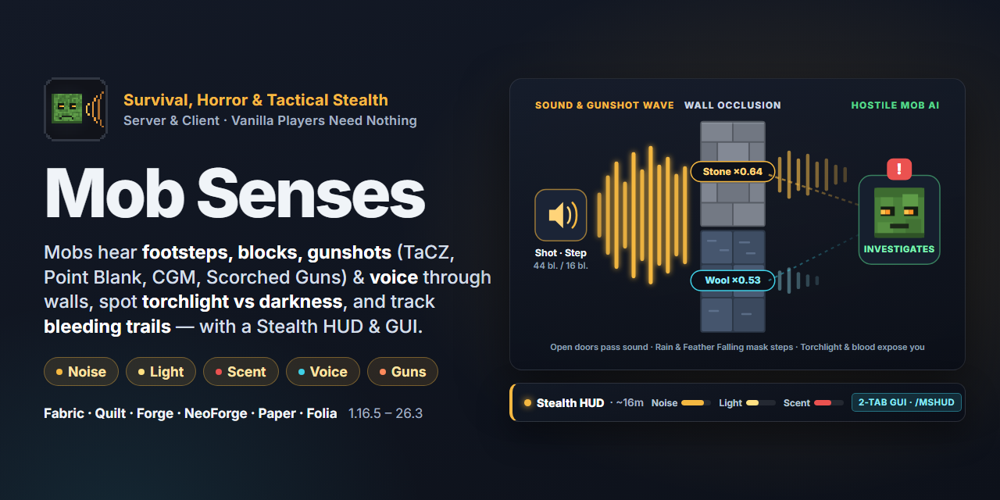
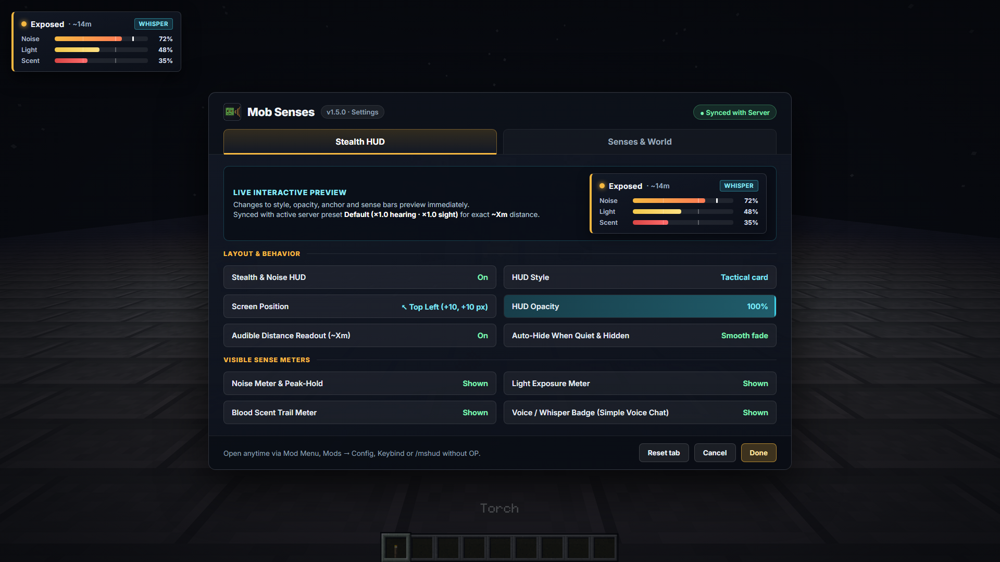
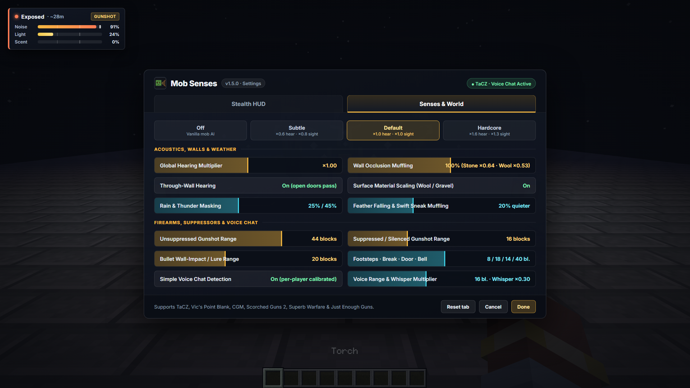
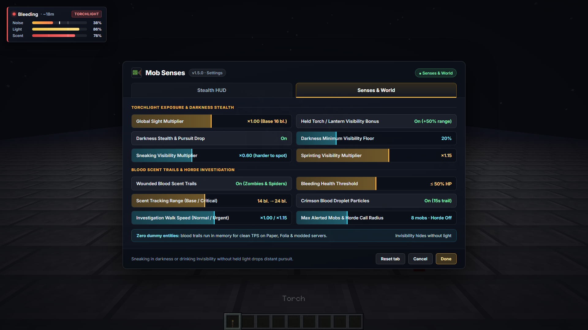
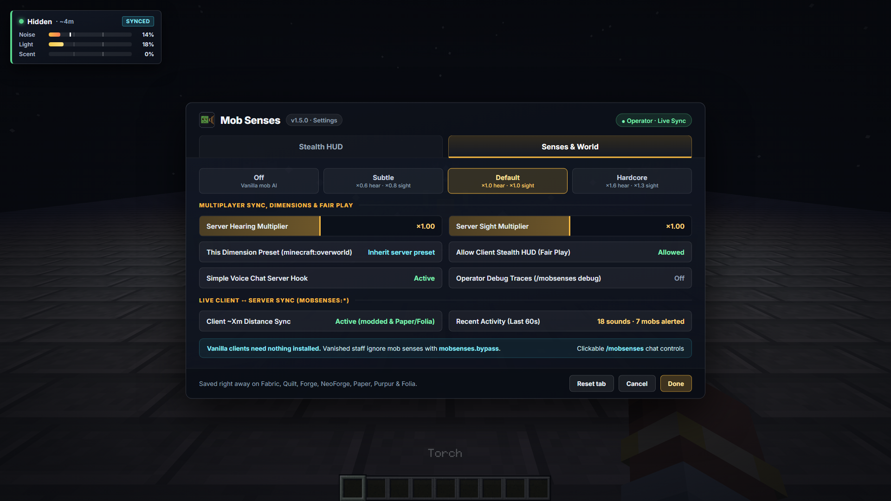
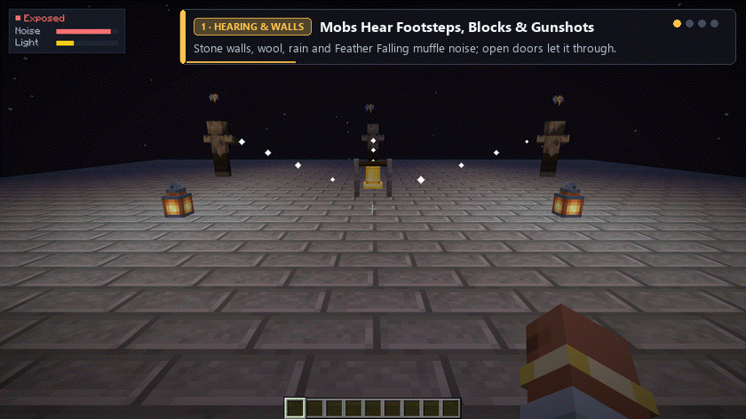
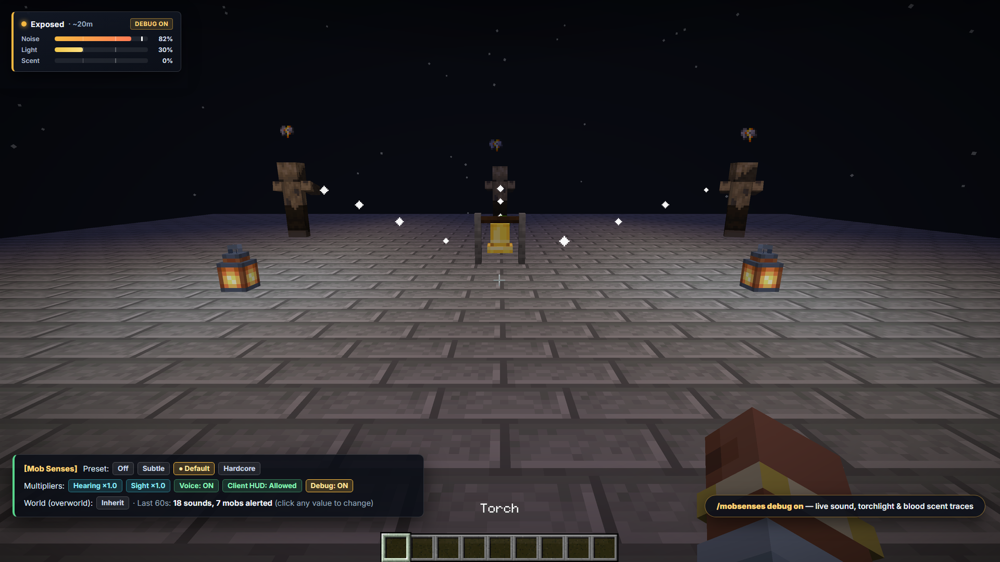

<a href="README.md">English</a> · <b>Русский</b>

Мобы слышат шаги, блоки, выстрелы (с учётом глушителей!) и <a href="https://modrinth.com/plugin/simple-voice-chat">Simple Voice Chat</a> сквозь стены, замечают свет факела в руке, теряют след в темноте и идут по кровавому следу — с тактическим Stealth HUD и лаконичным 2-вкладочным меню настроек для Fabric, Quilt, Forge, NeoForge, Paper и Folia.

| Stealth HUD и живой предпросмотр | Слух, оружие и голосовой чат |
|---|---|
|  |  |

| Свет факела, темнота и след крови | Живая синхронизация с сервером |
|---|---|
|  |  |

В ванильной игре враждебные мобы замечают вас только в пределах фиксированного радиуса. С **Mob Senses** у них появляются настоящие чувства:

- **Слух и преграды.** Бег громкий, шаги на корточках тихие, шерсть и ковёр глушат шаги, а гравий и металл выдают. Шумят и ломание с установкой блоков, двери, сундуки, бой, стрелы, выстрелы, взрывы, колокола, нотные блоки и еда. Моб, который услышал шум, идёт **к месту, откуда он донёсся**, осматривается и возвращается к своим делам. Каменные стены (`×0.64`), шерсть (`×0.53`), дождь, гроза, ботинки с «Невесомостью» и поножи с «Проворством» глушат шум, стекло и дерево слабее, а открытая дверь пропускает его.
- **Оружейные моды и глушители.** Нативная поддержка **TaCZ**, **Vic's Point Blank**, **MrCrayfish's Gun Mod**, **Scorched Guns 2**, **Superb Warfare** и **Just Enough Guns**: выстрелы без глушителя слышны далеко (`44` блока), глушитель снижает звук до ближней дистанции (`16` блоков), а попадание пули в далёкую стену (`20` блоков) выманивает и отвлекает мобов к точке удара.
- **Голос** *(с [Simple Voice Chat](https://modrinth.com/plugin/simple-voice-chat))*. Мобы слышат, как вы говорите. Крик разносится далеко, шёпот слышно только вблизи; громкость автоматически калибруется относительно обычного голоса каждого игрока, так что тихий микрофон не даёт бесплатной скрытности.
- **Свет, темнота и запах крови.** Факел или фонарь в руке делает вас заметным издалека (`+50%`), а темнота, присед и зелье невидимости прячут и сбрасывают далёкую погоню. Тяжело раненный игрок (`≤ 50%` здоровья) оставляет след с каплями крови на земле, по которому идут зомби и пауки — без спавна лишних сущностей в мире.
- **Stealth HUD и лаконичное 2-вкладочное GUI.** У игроков с клиентским модом есть настраиваемый HUD скрытности и 2-вкладочный экран настроек (*Stealth HUD* с живым интерактивным предпросмотром + *Senses & World*), автоматически синхронизирующийся с модовыми серверами и Paper/Folia — при этом **ванильные клиенты заходят без каких-либо модов**.

**Продвинутая замена Zombie Awareness нового поколения** — с честным просчётом стен и материалов, акустикой огнестрельного оружия и глушителей, реакцией на голос в **Simple Voice Chat**, скрытностью в темноте, клиентским **Stealth HUD** и **2-вкладочным GUI**, и **без библиотек-зависимостей** (не нужен CoroUtil) в трёх универсальных файлах для **Minecraft 1.16.5 – 26.3** на **Fabric, Quilt, Forge, NeoForge, Paper и Folia**.

## Содержание

- [Быстрый старт](#быстрый-старт)
- [Как мобы вас чувствуют](#как-мобы-вас-чувствуют)
- [Для игроков](#для-игроков)
- [Для серверов](#для-серверов)
- [Что работает где](#что-работает-где)
- [Версии и файлы](#версии-и-файлы)
- [Команды и права](#команды-и-права)
- [Файлы настроек](#файлы-настроек)
- [Совместимость](#совместимость)
- [Вопросы и проблемы](#вопросы-и-проблемы)
- [Сборка](#сборка)

## Быстрый старт

**Какой файл выбрать:** один универсальный `.jar` подходит для Fabric и Quilt (`1.16.5 – 26.3`), один универсальный `.jar` — для Forge (`1.16.5 – 26.3`) и NeoForge (`1.20.1 – 26.3`), и один универсальный плагин `.jar` — для Paper, Purpur, Folia, Spigot и Bukkit (`1.16.5 – 26.3`). Точные имена файлов и версии Java приведены в разделе [Версии и файлы](#версии-и-файлы).

**Сервер**
1. Fabric, Quilt, Forge или NeoForge: положите `.jar` мода в `mods/` (на Fabric и Quilt также нужен [Fabric API](https://modrinth.com/mod/fabric-api)). Paper, Purpur, Folia или Spigot: положите `mob-senses-bukkit-*.jar` в `plugins/`.
2. Запустите сервер. Игроки заходят с любым клиентом, **включая чистый ванильный** — им ничего не нужно устанавливать.
3. Выберите остроту чувств мобов командой `/mobsenses preset subtle|default|hardcore`, на вкладке **Senses & World** в меню настроек или в [`mobsenses-server.properties`](#серверный-файл).

**Игрок и одиночная игра**
1. Положите `.jar` мода в `.minecraft/mods/` (плюс [Fabric API](https://modrinth.com/mod/fabric-api) на Fabric/Quilt; [Mod Menu](https://modrinth.com/mod/modmenu) по желанию).
2. В одиночной игре встроенный сервер сам включает все чувства мобов. На серверах в мультиплеере клиентская часть даёт **Stealth HUD** и **2-вкладочный экран настроек**.
3. Открыть настройки можно в любой момент через **Mod Menu** (Fabric/Quilt), **Mods → Config** (Forge/NeoForge), назначенную клавишу (*Mob Senses…* в настройках управления) или командой `/mshud`.

[Simple Voice Chat](https://modrinth.com/plugin/simple-voice-chat) не обязателен: без него работает всё, кроме реакции на голос.

## Как мобы вас чувствуют

### Слух и глушение стенами
- **Движение и поверхность:** обычный шаг слышен на `8` блоков по умолчанию, бег — в `×1.75` дальше, а шаг в приседе — всего `×0.25`. Шерсть и ковёр глушат шаги, а гравий, металл и аметист выдают игрока. Ботинки с «Невесомостью» (*Feather Falling*) и поножи с «Проворством» (*Swift Sneak*) снижают шум шагов на `20%`.
- **Действия в мире:** ломание (`18` блоков) и установка (`12` блоков) блоков, двери/люки/калитки (`14`), сундуки/бочки/шалкеры (`12`), ближний бой (`16`), стрелы и снаряды (`15`), взрывы (`48`), колокола (`40`), нотные блоки (`28`) и еда/зелья (`8`) издают звук с настраиваемой дальностью.
- **Трассировка звука сквозь стены:** каждый звук проверяет блоки на пути к каждому мобу. Каменные и кирпичные стены режут слышимость (`×0.64` за блок), шерсть глушит ещё сильнее (`×0.53`), дерево и стекло задерживают меньше, а открытые двери, люки и калитки свободно пропускают звук. Дождь (`25%`) и гроза (`45%`) маскируют уличный шум.
- **ИИ расследования:** встревоженный моб идёт **именно к точке, откуда донёсся звук**, осматривается (`8 с` по умолчанию, двигаясь быстрее на тревожные звуки вроде выстрелов, колокола и взрывов) и возвращается к своим делам, если вы спрятались. Как только моб вступает в бой, цель расследования мгновенно уступает обычному боевому ИИ.

### Огнестрельное оружие, глушители и отвлечение пулями
- Нативная поддержка **[TaCZ](https://modrinth.com/mod/timeless-and-classics-zero)** (*Timeless and Classics Zero*), **Vic's Point Blank**, **MrCrayfish's Gun Mod (CGM)**, **Scorched Guns 2**, **Superb Warfare** и **Just Enough Guns**.
- **Выстрелы без глушителя** разносятся по всей округе (`44` блока по умолчанию) и стягивают ближайших мобов к стрелку.
- **Глушители и саундмодераторы** распознаются прямо на оружии и сокращают слышимость выстрела до ближней дистанции (`16` блоков).
- **Тактическое отвлечение выстрелом в стену:** попадание пули в далёкую стену создаёт шум в точке удара (`20` блоков), позволяя тихим выстрелом с глушителем выманить или увести орду в сторону от прохода.
- **Индивидуальная настройка стволов:** для любого оружия можно задать свою дальность по ID или ключевому слову в `mobsenses-server.properties` (например, `gun.tacz\:ai_awp.range=85` или `gun.glock.silenced_range=8`).

### Голосовой чат *(по желанию)*
- Если установлен [Simple Voice Chat](https://modrinth.com/plugin/simple-voice-chat), разговор рядом с враждебными мобами привлекает их внимание (`16` блоков для громкой речи, `×0.3` для шёпота).
- **Автокалибровка под микрофон:** громкость отсчитывается от обычного уровня речи каждого конкретного игрока, поэтому тихий микрофон не даёт нечестного преимущества, шёпот остаётся тихим, а крик разносится далеко.
- Корректно работает бок о бок с [Sound Physics Remastered](https://modrinth.com/mod/sound-physics-remastered).

### Свет факела, скрытность в темноте и след крови
- **Свет в руке:** факел, фонарь душ, обычный фонарь, светокамень, грибосвет или огненный стержень в руке увеличивают дальность, с которой мобы вас замечают (`+50%` по умолчанию).
- **Скрытность в темноте:** присед в темноте или зелье невидимости (если в руке нет источника света) сокращают дальность зрения мобов до `20%` и позволяют оторваться от далёких преследователей.
- **След крови и призыв орды:** тяжело раненые игроки (`≤ 50%` здоровья) оставляют быстрый след в памяти сервера (`14–24` блока на `15 с`) с каплями крови на земле, по которому идут зомби и пауки, а встревоженные мобы при желании зовут ближайших сородичей (`horde_alert_range`) — **без спавна невидимых сущностей-маркеров** в мире.

## Для игроков

- **Тактический и минималистичный Stealth HUD:** выбирайте между карточкой **Tactical** (скошенные углы, динамическая иконка глаза скрытности, риски порогов `30%`/`65%`, маркер удержания пиков) и тонкой полоской **Minimal**. Показывает текущий шум, примерный радиус слышимости (`~Xм`), освещённость, след крови и метки `[Голос]` / `[Шёпот]`, а также плавно скрывается в тишине.
- **Лаконичный 2-вкладочный экран настроек в тёмно-сланцевом стиле:**
  - **Stealth HUD** — включает **живой интерактивный предпросмотр HUD**, настройку видимости, стиля *Tactical* / *Minimal*, компактной шапки, угла экрана, пиксельных отступов, прозрачности, радиуса `~Xм`, плавного автоскрытия и отдельных полосок.
  - **Senses & World** — пресеты (`Off`, `Subtle`, `Default`, `Hardcore`), ползунки слуха и глушения стенами, дальность выстрелов / глушителей / попаданий пуль, Simple Voice Chat, свет факела и темнота, параметры следа крови и призыва орды, пресет текущего измерения и показ клиентского HUD (напрямую меняет настройки одиночного мира или синхронизируется вживую для операторов на сервере).
- **Удобное открытие:** через **Mod Menu** на Fabric/Quilt, **Mods → Config** на Forge/NeoForge, свою клавишу (*Mob Senses…* в управлении) или командой `/mshud` (`/mobsenseshud`) **на любом сервере без прав оператора**.
- **Семь языков:** английский, русский, украинский, немецкий, испанский, бразильский португальский и китайский (упрощённый).

## Для серверов

Доступно как в универсальных модах для Fabric/Quilt и Forge/NeoForge, так и в виде отдельного серверного плагина (`mob-senses-bukkit-*.jar`) для **Paper, Purpur, Folia, Spigot и Bukkit**.

- **Ванильным клиентам ничего не нужно.** Весь слух, зрение, реакция на голос и запах крови работают на стороне сервера.
- **Четыре пресета и баланс по измерениям:**

  | Пресет | Слух | Зрение | Для чего подходит |
  |---|---|---|---|
  | **Выключено** (`off`) | — | — | Ванильное поведение мобов (мирные измерения, креативные миры) |
  | **Мягкий** (`subtle`) | `×0,6` | `×0,8` | Строительные и спокойные серверы: мобы реагируют только на сильный шум |
  | **Обычный** (`default`) | `×1,0` | `×1,0` | Выживание и тактические сборки |
  | **Хардкор** (`hardcore`) | `×1,6` | `×1,3` | Хоррор, зомби-апокалипсис и хардкор: важен каждый шаг |

  Для любого измерения можно задать свой пресет командой `/mobsenses world <мир|here> <пресет|inherit>`.
- **Лёгкая синхронизация клиента и сервера (`mobsenses:*`) и честная игра.** У игроков с клиентским модом (в том числе при входе на серверы **Paper, Purpur и Folia**!) HUD автоматически получает активный пресет и множители сервера или измерения для точного расчёта `~Xм`, а операторы сервера могут менять пресеты и ползунки на лету прямо на вкладке **Senses & World**. Для соревновательного PvP или хоррор-ивентов настройка `allow_client_hud=false` скрывает клиентский HUD.
- **Кликабельные ответы `/mobsenses`, обход для персонала и поддержка Folia.** В ответах `/mobsenses` есть кнопки для быстрого переключения пресетов и параметров прямо из чата; право `mobsenses.bypass` позволяет модераторам в ванише не тревожить мобов лишним шумом, светом и запахом крови; а на **Folia** поиск пути выполняется безопасно в потоке региона каждого моба (`folia-supported: true`).

## Что работает где

| Возможность | Только клиент | Только сервер: мод | Только сервер: плагин Paper/Folia | Оба (клиент + сервер) |
|---|:---:|:---:|:---:|:---:|
| Слух мобов, стены, свет, темнота и след крови | В одиночной игре | ✅ для всех (и ванильных клиентов) | ✅ для всех (и ванильных клиентов) | ✅ |
| Огнестрельное оружие и глушители (TaCZ, Point Blank, CGM, Scorched Guns 2, Superb Warfare, JEG) | В одиночной игре | ✅ | Луки, арбалеты, взрывы и ближний бой | ✅ |
| Реакция на Simple Voice Chat | В одиночной игре | ✅ (с SVC) | ✅ (с плагином SVC) | ✅ |
| Stealth HUD и `/mshud` (`tactical` / `minimal`) | ✅ (локальный шум и свет) | — | — | ✅ + синхронизация пресета, `[Голос]` и запрета HUD |
| 2-вкладочное GUI (*Stealth HUD* + *Senses & World*) | ✅ (клиент + одиночная игра) | — | — | ✅ + живая настройка для OP на модах и Paper/Folia |
| Пресеты измерений (`/mobsenses world`), кликабельный `/mobsenses` и `mobsenses.bypass` | В одиночной игре | ✅ | ✅ | ✅ |

## Версии и файлы

| Загрузчик | Minecraft | Файл | Java | Примечание |
|---|---|---|---|---|
| **Fabric / Quilt** | `1.16.5 – 26.3` | `mob-senses-fabric-…+mc1.16.5-26.x.jar` | 8+ (как у Minecraft) | Нужен [Fabric API](https://modrinth.com/mod/fabric-api); [Mod Menu](https://modrinth.com/mod/modmenu) по желанию |
| **Forge / NeoForge** | Forge `1.16.5 – 26.3`, NeoForge `1.20.1 – 26.3` | `mob-senses-forge-neoforge-…+mc1.16.5-26.x.jar` | 8+ (как у Minecraft) | Один универсальный файл и для Forge, и для NeoForge |
| **Paper / Purpur / Folia / Spigot / Bukkit** | `1.16.5 – 26.3` | `mob-senses-bukkit-….jar` | 8+ (17+ на 1.18+) | Серверный плагин (`folia-supported: true`); клиентам моды не нужны |

- **Всего три универсальных файла.** Каждый `.jar` содержит нативные сборки под весь диапазон `1.16.5 – 26.3` и сам выбирает нужную при запуске игры.
- **Полное равенство старых версий:** `1.16.5`, `1.17.1`, `1.18.2`, `1.19.2` и `1.19.4` поддерживают все возможности v1.5.0 на Fabric, Quilt, Forge и Paper (сам Forge пропускал `1.20.5` и `1.21.2`; NeoForge `1.20.1` загружает общий файл Forge/NeoForge автоматически).
- **Версия Java:** та, на которой работает ваша версия Minecraft (`8` для `1.16.5`, `16` для `1.17.1`, `17` для `1.18 – 1.20.4`, `21` для `1.20.5 – 1.21.11`, `25` для `26.x`).

## Команды и права

### Для игроков: `/mshud` (`/mobsenseshud`)

Доступна **каждому игроку на любом сервере без прав оператора** (в одиночной игре без читов также работает `/mobsenses hud`).

| Команда | Что делает |
|---|---|
| `/mshud` | Открыть 2-вкладочный экран настроек Mob Senses |
| `/mshud on\|off` | Показать или скрыть клиентский Stealth HUD |
| `/mshud tactical\|minimal` | Переключить стиль между карточкой *Tactical* и полоской *Minimal* |
| `/mshud compact\|full` | Компактный режим (только шапка) или полные шкалы |
| `/mshud <top_left\|top_right\|bottom_left\|bottom_right\|top_center\|hotbar>` | Переместить HUD в любой угол экрана или над хотбаром |
| `/mshud offset <x> <y>` | Задать сдвиг в пикселях от выбранного края |
| `/mshud opacity <10-100>` | Настроить непрозрачность HUD в процентах |
| `/mshud auto_hide [on\|off]` | Плавное автоскрытие HUD, когда вокруг тихо, темно и нет кровотечения |
| `/mshud range [on\|off]` | Показ расчётного радиуса слышимости (`~Xм`) |
| `/mshud bar <noise\|light\|scent\|voice> [on\|off]` | Включить или скрыть отдельные полоски и метки |
| `/mshud reset` | Сбросить настройки клиентского HUD к значениям по умолчанию |

### Для серверов: `/mobsenses`

`/mobsenses` доступна операторам (уровень 2+) и консоли (право `mobsenses.admin` на Paper/Folia). Ответы приходят на языке игрока и содержат **кликабельные кнопки** в чате для быстрого переключения пресетов и параметров.

| Команда | Что делает |
|---|---|
| `/mobsenses` или `/mobsenses status` | Версия, пресет, множители, Simple Voice Chat, пресет измерения и счётчики событий и встревоженных мобов за минуту (с кликабельными кнопками) |
| `/mobsenses preset <off\|subtle\|default\|hardcore>` | Выбрать общий пресет сервера |
| `/mobsenses hearing <0-3>` / `/mobsenses sight <0-3>` | Общие множители слуха и зрения поверх пресета |
| `/mobsenses voice <on\|off>` | Включить или выключить реакцию мобов на Simple Voice Chat |
| `/mobsenses world <мир\|here> <пресет\|inherit>` | Задать пресет для отдельного измерения (`inherit` возвращает общий пресет сервера) |
| `/mobsenses set <параметр> [значение\|default]` | Посмотреть или изменить любую настройку из `mobsenses-server.properties` прямо в игре (с подсказками Tab) |
| `/mobsenses get <параметр\|категория>` | Посмотреть один параметр или целую категорию (`core`, `guns`, `sounds`, `stealth`, `voice`, `sight`, `scent`, `mobs`, `all`) |
| `/mobsenses reset <параметр\|all>` | Сбросить один параметр или весь серверный конфиг к значениям по умолчанию |
| `/mobsenses debug [on\|off]` | Включить отладочные линии из частиц для операторов (пути звука, света и следа крови к мобам) |
| `/mobsenses reload` | Перечитать `mobsenses-server.properties` с диска |
| `/mobsenses help` | Кликабельная справка по командам |

### Права

| Право (Permission) | По умолчанию | Что разрешает |
|---|---|---|
| `mobsenses.admin` | `op` | Полный доступ к `/mobsenses` и живому редактированию вкладки *Senses & World* для операторов |
| `mobsenses.bypass` | `false` | Мобы игнорируют дополнительный шум, свет факела в руке и запах крови этого игрока (по умолчанию `false`, чтобы операторы могли нормально проверять реакцию мобов в игре, пока право не выдано явно) |

## Файлы настроек

Файлы конфигурации создаются с двуязычными комментариями при первом запуске и перечитываются автоматически при сохранении — перезапуск игры или сервера не нужен.

### Серверный файл

`config/mobsenses-server.properties` (Fabric, Quilt, Forge, NeoForge) или `plugins/MobSenses/mobsenses-server.properties` (Paper, Purpur, Folia, Spigot).

<b>Все серверные настройки (`mobsenses-server.properties`)</b>

| Ключ | По умолчанию | Значение |
|---|---|---|
| `preset` | `default` | Общий пресет: `off`, `subtle`, `default` или `hardcore` |
| `hearing`, `sight` | `1`, `1` | Общие множители слуха и зрения (`0` – `3`), умножаются на активный пресет |
| `allow_client_hud` | `true` | `false` скрывает клиентский Stealth HUD у обычных игроков на соревновательных PvP и хоррор-серверах |
| `wall_muffling`, `through_wall_hearing`, `surface_sound_scaling` | `1`, `true`, `true` | Сила глушения стенами (`0` – `3`), проходят ли громкие звуки сквозь сплошные стены вообще, и влияют ли шерсть/металл/гравий на шум шагов |
| `gunshot_range`, `gunshot_silenced_range`, `bullet_impact_range` | `44`, `16`, `20` | Дальность слышимости в блоках (`0` – `256`, `0` = выкл) для обычных выстрелов, выстрелов с глушителем и попаданий пуль в дальние стены |
| `gun.<id>.range`, `gun.<id>.silenced_range` | — | Индивидуальная дальность для оружия по ID или слову (`gun.tacz\:ai_awp.range=85`, `gun.glock.silenced_range=8`) |
| `step_range`, `sneak_step_multiplier`, `sprint_step_multiplier` | `8`, `0.25`, `1.75` | Базовая дальность обычных шагов (`0` – `256` блоков) и множители в приседе и на бегу |
| `block_break_range`, `block_place_range`, `door_range`, `container_range`, `combat_range`, `projectile_range`, `explosion_range`, `bell_range`, `note_block_range`, `eat_range` | `18`, `12`, `14`, `12`, `16`, `15`, `48`, `40`, `28`, `8` | Базовая дальность слышимости в блоках (`0` – `256`, `0` = выключено) для каждой категории звуков |
| `rain_muffling`, `thunder_muffling`, `feather_falling_muffling` | `0.25`, `0.45`, `0.2` | Снижение шума в дождь (`25%`), в грозу (`45%`) и от ботинок с «Невесомостью» или поножей с «Проворством» (`20%`) |
| `voice`, `voice_range`, `voice_whisper_multiplier` | `true`, `16`, `0.3` | Включение Simple Voice Chat, дальность громкой речи (`0` – `256` блоков) и множитель шёпота (`0` – `1`) |
| `sight_range`, `held_light_enabled`, `held_light_bonus`, `darkness_stealth_enabled`, `darkness_min_visibility`, `sneak_sight_multiplier`, `sprint_sight_multiplier` | `16`, `true`, `0.5`, `true`, `0.2`, `0.6`, `1.15` | Базовая дальность зрения (`0` – `256`), бонус заметности от света в руке, порог скрытности в темноте и множители позы |
| `scent_enabled`, `scent_health_threshold`, `scent_range`, `scent_max_range`, `scent_duration_seconds`, `blood_particles`, `scent_mobs` | `true`, `50`, `14`, `24`, `15`, `true`, — | Запах крови, порог здоровья (`5` – `100%`), базовый и максимальный радиус чутья (`0` – `256` блоков), время жизни следа (`с`), капли крови и дополнительные мобы-ищейки |
| `investigate_speed`, `urgent_investigate_speed`, `investigation_seconds` | `1`, `1.15`, `8` | Скорость хода мобов при проверке обычных и тревожных (`gunshot`, `explosion`, `bell`) звуков и длительность осмотра в секундах |
| `max_alerted_mobs`, `horde_alert_range`, `horde_max_allies`, `alert_cooldown_ms` | `8`, `0`, `4`, `900` | Максимум мобов на одно событие (`1` – `64`), радиус призыва орды (`0` – `64`, `0` = выкл), максимум союзников на моба и кулдаун в `мс` |
| `extra_listeners`, `ignored_mobs` | — | Списки ID мобов или масок `namespace:*` через запятую для добавления или исключения из Mob Senses |
| `language` | `en_us` | Язык по умолчанию для консоли и игроков с неизвестной локалью |
| `world.<id>.preset` | — | Пресет отдельного измерения (`world.minecraft\:the_nether.preset=off` на модах; `world.world_nether.preset=off` на Paper) |

### Клиентский файл HUD

`config/mobsenses-client.properties` — создаётся на клиенте и перечитывается сразу при сохранении (меняется на вкладке **Stealth HUD**, командой `/mshud` или прямо в файле):

| Ключ | По умолчанию | Значение |
|---|---|---|
| `enabled` | `true` | Показывать (`true`) или скрыть (`false`) HUD скрытности и шума |
| `style` | `tactical` | `tactical` (карточка с иконкой скрытности, рисками порогов и удержанием пиков) или `minimal` (тонкая полоска) |
| `position` | `top_left` | `top_left`, `top_right`, `bottom_left`, `bottom_right`, `top_center` или `hotbar` |
| `x`, `y` | `10`, `10` | Отступ в пикселях от выбранной позиции |
| `opacity` | `100` | Непрозрачность HUD в процентах (`10` – `100`) |
| `compact` | `false` | `true` оставляет только шапку статуса без полосок |
| `auto_hide` | `false` | `true` плавно скрывает HUD, пока вокруг тихо, темно, нет кровотечения и вы молчите |
| `show_range` | `true` | Показывать расчётный радиус слышимости в блоках (`~Xм`) во время шума |
| `show_noise`, `show_light`, `show_scent`, `show_voice` | `true` | Показ отдельных полосок и индикатора `[Голос]` / `[Шёпот]` |

## Совместимость

- **Модпаки:** мод можно свободно включать в любые модпаки — **никаких сторонних библиотек** (вроде CoroUtil) не требуется.
- **Ванильные клиенты:** свободно заходят на серверы с модом или плагином Paper/Folia; лёгкий канал синхронизации `mobsenses:*` включается только если у игрока тоже установлен Mob Senses.
- **Оружейные моды:** нативная поддержка **TaCZ** (*Timeless and Classics Zero*), **Vic's Point Blank**, **MrCrayfish's Gun Mod (CGM)**, **Scorched Guns 2**, **Superb Warfare** и **Just Enough Guns** (обычные выстрелы, глушители, попадание пуль в дальние стены и настройки `gun.<id>.*`).
- **Голосовой чат и звук:** опциональная интеграция с [Simple Voice Chat](https://modrinth.com/plugin/simple-voice-chat); полная совместимость с [Sound Physics Remastered](https://modrinth.com/mod/sound-physics-remastered) и **Voice Physics**.
- **Свои мобы и мобы из модов:** поддерживаются датапак-теги сущностей (`#mobsenses:listeners`, `#mobsenses:scent_trackers`) и списки `extra_listeners` / `ignored_mobs` (включая маски `namespace:*`), совместимо с *In Control!*, *Enhanced AI*, *Improved Mobs* и многопоточной **Folia**.

### Чем Mob Senses лучше Zombie Awareness

| Возможность | Mob Senses | Zombie Awareness |
|---|---|---|
| **Стены и материалы поверхностей** | Луч проверяет преграды: камень (`×0.64`) и шерсть (`×0.53`) глушат звук, открытые двери пропускают, дождь и «Невесомость» маскируют шаги | Игнорирует стены (простая проверка радиуса) |
| **Оружейные моды и глушители** | Нативная поддержка **TaCZ, Point Blank, CGM, Scorched Guns 2, Superb Warfare и JEG**: глушители, отвлечение попаданием пули в стену и дальность под каждый ствол | Только общий хук на звук (без глушителей и точки попадания пули) |
| **Simple Voice Chat** | Встроенная поддержка с автокалибровкой под микрофон каждого игрока (шёпот и крик) | Отсутствует |
| **Скрытность в темноте и свет** | Факел в руке выдаёт издалека; присед в темноте или невидимость прячут и сбрасывают далёкую погоню | Только приманка на свет; темнота не прячет |
| **След крови и нагрузка на сервер (TPS)** | Не спавнит лишних сущностей в мире; быстрый расчёт следа в памяти и капли крови на земле | Спавнит невидимые сущности-маркеры в мире |
| **Клиентский HUD и меню настроек** | Тактический HUD, лаконичное 2-вкладочное GUI с предпросмотром, синхронизация с сервером и кликабельный `/mobsenses` | Только конфиг / базовые настройки; нет Stealth HUD |
| **Зависимости и платформы** | **Без библиотек** (не нужен CoroUtil) · **1 универсальный jar** на загрузчик для **1.16.5 – 26.3** (Fabric, Quilt, Forge, NeoForge, Paper, Folia) | Требует **CoroUtil** · Отдельные файлы под версии · Нет Paper/Folia |

## Вопросы и проблемы

- **Как увидеть в игре, что именно слышат мобы?** Включите `/mobsenses debug on` от имени оператора, чтобы видеть линии из частиц от источника звука, факела в руке или следа крови к встревоженным мобам, а `/mobsenses status` покажет статистику за последнюю минуту.
- **Почему на сервере пропал мой Stealth HUD?** Администратор сервера выключил показ клиентского индикатора (`allow_client_hud=false`) для честного PvP или хоррор-режима.
- **Как отключить или ослабить Mob Senses в отдельном измерении?** Выполните `/mobsenses world here off` (или `/mobsenses world <измерение> subtle`).
- **Нашли ошибку или есть идея?** [Создайте issue на GitHub](https://github.com/Shamanalle/mob-senses/issues).

## Сборка

JDK 25 (а также JDK 17 и JDK 8, которые Gradle находит через toolchains для совместимости со старыми версиями): `./gradlew build` собирает три универсальных файла релиза в `build/libs/`. Устройство модулей и игровые тесты описаны в [CONTRIBUTING.md](CONTRIBUTING.md).

## Лицензия

[MIT](LICENSE).
