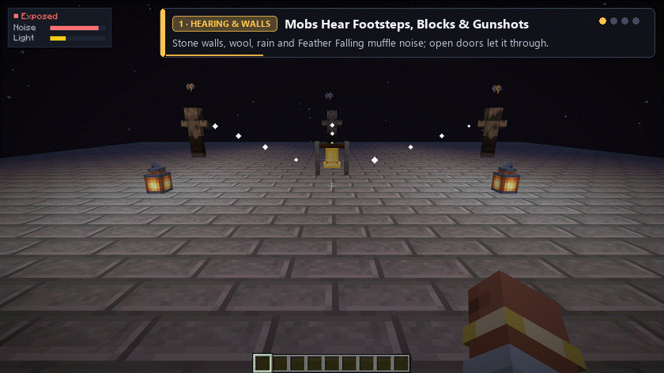
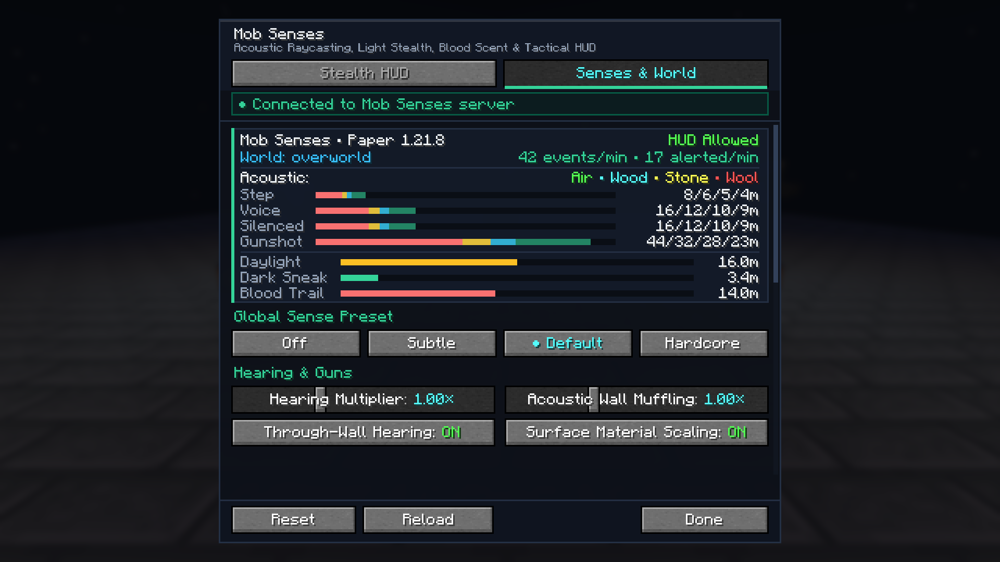

A survival, horror and stealth plugin for **Paper, Purpur, Folia and Spigot** (Minecraft 1.16.5 – 26.3) that gives hostile mobs real senses: **mobs hear footsteps, blocks, combat and [Simple Voice Chat](https://hangar.papermc.io/henkelmax/SimpleVoiceChat) through walls, spot held torchlight vs darkness, and track wounded players' blood trails.**

Players **need nothing installed** — vanilla clients join out of the box, and every sense runs on the server. Players who also install the optional [Mob Senses client mod](https://github.com/Shamanalle/mob-senses/releases) get the Tactical Stealth HUD (with live `[?]`/`[!]` mob alert badges) and sleek 2-tab settings screen synced live with your server.

## How mobs sense players

- **🧱 Hearing, decoys & wall occlusion** — sprinting is loud, sneaking is quiet, wool and carpet muffle footsteps while gravel, metal and rain-soaked ground give players away. Breaking and placing blocks, doors, chests, combat, arrows, explosions, bells, note blocks, eating and tossing items (`Q`) make noise too — players can throw items to distract guards and slip past under loud sound cover. Alerted mobs pause suspiciously at outer-range cues, walk to **where the sound came from** while avoiding lava and open trapdoors, fan out in a ring as a horde, and sweep or flee unseen ambushes instead of pinpointing stealth attackers. Stone walls (`×0.64`), wool (`×0.53`), rain, thunderstorms, *Feather Falling* boots and *Swift Sneak* leggings muffle noise, while open doors and trapdoors let sound pass.
- **🗣️ Proximity voice chat** *(optional, with [Simple Voice Chat](https://hangar.papermc.io/henkelmax/SimpleVoiceChat))* — mobs hear players speak. Shouting carries far while whispering stays close; loudness is calibrated automatically against each player's own normal speaking voice, so a quiet microphone gives no unfair stealth.
- **🔦 Torchlight & darkness stealth** — holding a torch, lantern or glowstone makes players visible from 50% farther away; sneaking in the dark or drinking an Invisibility potion (without held light) hides players and lets distant pursuers lose track of them.
- **🩸 Blood scent & horde alerts** — badly wounded players (at or below 50% health) leave a fast in-memory scent trail (muffled by solid walls) with crimson blood droplets on the ground that zombies and spiders follow, while bosses are skipped by default. Alerted mobs can optionally call nearby allies to investigate together — with **zero dummy marker entities** spawned in the world (safe for Folia region threads and high-player TPS).

## Tools for admins

- **Presets, per-world balance & 50+ live settings** — switch between **Off**, **Subtle** (`×0.6` hear, `×0.8` sight), **Default** (`×1.0`) and **Hardcore** (`×1.6` hear, `×1.3` sight), assign per-dimension presets with `/mobsenses world <world|here> <preset|inherit>`, or fine-tune any sound category, wall muffling, voice range, darkness stealth, blood trail or listener mob list in game with `/mobsenses set`.
- **Lightweight client sync & fair play** — automatically sync active server and world presets to players running the client mod so their `~Xm` HUD distance stays accurate, or hide their Stealth HUD (`allow_client_hud=false`) for competitive PvP and horror events. Operators with the client mod can also tune presets and sliders live from its **Senses & World** tab.
- **Clickable `/mobsenses`, staff bypass & debug traces** — clickable buttons in `/mobsenses` chat replies, `/mobsenses debug` particle traces for operators, `mobsenses.bypass` so vanished moderators trigger no extra mob senses, and replies localized in 7 languages.

## Install

1. Put `mob-senses-bukkit-*.jar` into `plugins/`. [Simple Voice Chat](https://hangar.papermc.io/henkelmax/SimpleVoiceChat) is optional and detected automatically.
2. Start the server. Settings live in `plugins/MobSenses/mobsenses-server.properties` (re-read automatically on save) and can all be changed live with `/mobsenses`.

- **Platforms:** Paper, Purpur, **Folia** (`folia-supported: true`), Spigot, Bukkit — one universal jar for **Minecraft 1.16.5 – 26.3** (Java 8+ on 1.16.5, Java 17+ on 1.18+).
- **Permissions:** `mobsenses.admin` (server administration, granted to operators by default) and `mobsenses.bypass` (mobs ignore extra noise, held torchlight and scent for this player; off by default).

**[All settings, commands and permissions →](https://github.com/Shamanalle/mob-senses#readme)** · [Changelog](https://github.com/Shamanalle/mob-senses/blob/main/CHANGELOG.md) · [Questions and problems](https://github.com/Shamanalle/mob-senses#questions-and-problems) · [Report a bug](https://github.com/Shamanalle/mob-senses/issues)

---

<b>🇷🇺 Русский</b>

Серверный плагин про выживание, хоррор и скрытность для **Paper, Purpur, Folia и Spigot** (Minecraft 1.16.5 – 26.3): **враждебные мобы слышат шаги, блоки, бой и [Simple Voice Chat](https://hangar.papermc.io/henkelmax/SimpleVoiceChat) сквозь стены, замечают свет факела в руке, теряют след в темноте и идут по кровавому следу раненых игроков.**

Игрокам **не нужно ничего устанавливать** — подходят обычные ванильные клиенты. А тем, кто поставит опциональный клиентский мод Mob Senses, добавятся тактический Stealth HUD и лаконичное 2-вкладочное меню настроек с живой синхронизацией от сервера.

### Что получают игроки и админы

- **🧱 Слух, приманки и преграды** — бег громкий, шаг в приседе тихий, шерсть глушит шаги, а гравий, металл и мокрая под дождём земля выдают; брошенный предмет (`Q`) отвлекает мобов, а громкие звуки маскируют тихие шаги. Настороженные мобы сначала прислушиваются (`?`), обходят лаву и открытые люки, рассредотачиваются кольцом и прочёсывают или убегают от скрытой засады. Каменные стены (`×0.64`), шерсть (`×0.53`), дождь, гроза, «Невесомость» и «Проворство» глушат звук, а открытые двери пропускают его.
- **🗣️ Simple Voice Chat, свет и запах крови** — мобы слышат речь (с автокалибровкой под микрофон каждого игрока), видят факел в руке издалека, теряют игрока в темноте и идут по следу крови (`≤ 50%` здоровья, ослабляемому сплошными стенами; боссы пропускаются автоматически) без спавна сущностей-пустышек в мире (безопасно для TPS и потоков Folia).
- **⚙️ Пресеты, синхронизация и инструменты админа** — общие пресеты (`off`, `subtle`, `default`, `hardcore`) и пресеты для отдельных измерений (`/mobsenses world`), кликабельные ответы `/mobsenses`, частицы `/mobsenses debug`, скрытие клиентского HUD для честного PvP (`allow_client_hud=false`) и право `mobsenses.bypass` для администрации в ванише.

**[Все настройки, команды и права →](https://github.com/Shamanalle/mob-senses/blob/main/README.ru.md)** · [Список изменений](https://github.com/Shamanalle/mob-senses/blob/main/CHANGELOG.md) · [Сообщить об ошибке](https://github.com/Shamanalle/mob-senses/issues)

