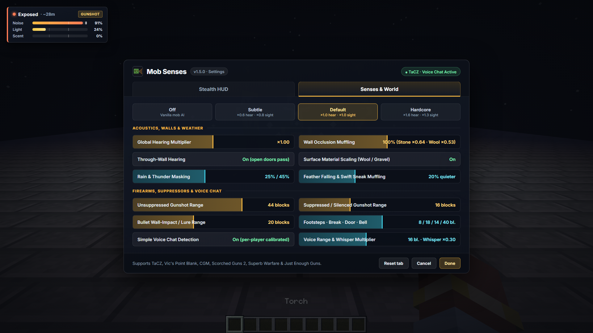
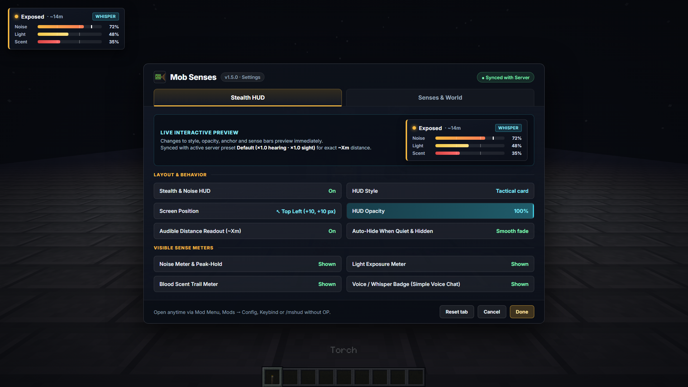
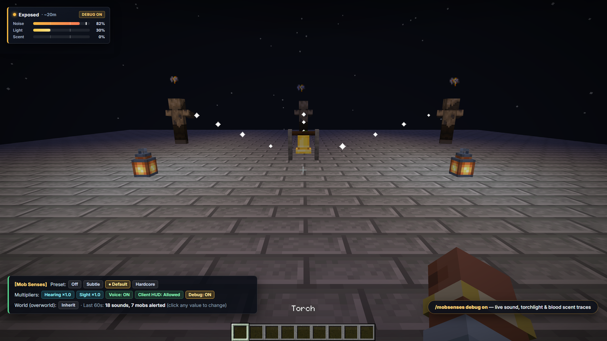

Hostile mobs in vanilla notice you only within a fixed radius. With **Mob Senses**, they use their senses: **mobs hear footsteps, blocks, gunshots (with suppressors!) and [Simple Voice Chat](https://modrinth.com/plugin/simple-voice-chat) through walls, spot held torchlight vs darkness, and track bleeding trails — with a Tactical Stealth HUD and sleek 2-tab settings GUI.**

Install it on the server, on your client, or on both. **Vanilla clients can join a server running Mob Senses with nothing installed.**

## How mobs sense you

**👂 Hearing & wall occlusion**
- Running is loud, sneaking is quiet, wool and carpet muffle footsteps while gravel, metal and rain-soaked surfaces give you away.
- Breaking and placing blocks, doors, trapdoors, chests, barrels, combat, arrows, explosions, bells, note blocks, eating and tossing items (`Q`) make noise too — toss metal or bells as a decoy to lure guards away, and move under loud thunder or explosion cover.
- Mobs pause suspiciously at faint outer-range cues (`?`), walk to **where the sound came from** while avoiding lava and open trapdoor drops, fan out in a ring as a horde, and sweep or flee unseen ambushes instead of pinpointing stealth attackers.
- Stone walls (`×0.64`), wool (`×0.53`), rain (`25%`), thunderstorms (`45%`), *Feather Falling* boots and *Swift Sneak* leggings muffle sound; glass and wood block less, and open doors let sound pass.

**🔫 Firearms, suppressors & bullet lures**
- Native support for **TaCZ** (*Timeless and Classics Zero*), **Vic's Point Blank**, **MrCrayfish's Gun Mod (CGM)**, **Scorched Guns 2** (including quiet air/pneumatic guns), **Superb Warfare** and **Just Enough Guns**.
- Unsuppressed shots carry across the area (`44` blocks) and draw nearby mobs; attaching a suppressor or using integrally silenced firearms (*VSS*, *AS Val*, *MP5SD*, air guns) cuts the shot to close range (`16` blocks).
- Firing a silenced weapon into a distant wall creates noise where the bullet lands (`20` blocks) so you can distract or lure hordes away. Every weapon can also be tuned individually (`gun.<id>.range`).

**🗣️ Proximity voice chat** *(with [Simple Voice Chat](https://modrinth.com/plugin/simple-voice-chat))*
- Mobs hear you speak. A shout carries far, a whisper only next to them.
- Loudness is calibrated automatically against each player's own normal speaking voice, so a quiet microphone gives no free stealth. Works cleanly alongside [Sound Physics Remastered](https://modrinth.com/mod/sound-physics-remastered).

**🔦 Torchlight, darkness stealth & blood scent**
- Holding a torch, lantern or glowstone exposes you from 50% farther away; sneaking in darkness or drinking an Invisibility potion (without held light) hides you and drops distant pursuit.
- Badly wounded players (`≤ 50%` health) leave a fast in-memory scent trail (muffled by solid walls) with crimson blood droplets on the ground that zombies and spiders follow, alerted mobs can optionally call nearby allies as a horde, and bosses are excluded automatically — with **zero dummy marker entities** spawned in the world.

## For players

- **Tactical & minimal Stealth HUD:** chamfered *Tactical* card (stealth eye, `30%`/`65%` threshold ticks, peak-hold marker, live `[?]`/`[!]` alert badges) or slim *Minimal* strip showing noise, audible distance (`~Xm`), light exposure, blood scent and `[Voice]` / `[Whisper]` badges, with smooth auto-hide when quiet.
- **Sleek 2-tab dark-slate Settings GUI:** *Stealth HUD* (with live interactive preview) and *Senses & World*, opened from **Mod Menu** (Fabric/Quilt), **Mods → Config** (Forge/NeoForge), your own keybind (*Mob Senses…*), or `/mshud` on any server without operator permissions.
- **Lightweight client ↔ server sync:** when both client and server run Mob Senses (including **Paper, Purpur and Folia** servers!), your HUD automatically syncs the active server or dimension preset, multipliers and fair-play HUD rule. Seven languages.

## For servers

- **Zero client requirement:** server-side AI works for vanilla clients out of the box.
- **Presets & per-world balance:** switch between **Off**, **Subtle**, **Default** and **Hardcore**, or set per-dimension presets with `/mobsenses world <world|here> <preset|inherit>`.
- **Fair play & live operator GUI:** hide the client Stealth HUD (`allow_client_hud=false`) for competitive PvP or horror events, while server operators with the client mod tune presets and sliders live in the *Senses & World* tab.
- **Clickable `/mobsenses`, staff bypass & debug traces:** clickable buttons in `/mobsenses` chat replies, `/mobsenses debug` particle traces showing sound, light and blood paths to alerted mobs, and `mobsenses.bypass` so vanished moderators trigger no extra mob senses.

## Why Mob Senses vs Zombie Awareness

| Feature | Mob Senses | Zombie Awareness |
|---|---|---|
| **Walls & surface materials** | Raycasts through blocks: stone (`×0.64`) & wool (`×0.53`) muffle, open doors pass sound, rain & Feather Falling mask steps | Ignores walls (plain radius check) |
| **Firearm mods & suppressors** | Native **TaCZ, Point Blank, CGM, Scorched Guns 2, Superb Warfare & JEG**: silencers, bullet wall-impact lures & per-gun ranges | Generic sound hook only (no suppressor or bullet impact logic) |
| **Simple Voice Chat** | Built-in with per-player microphone auto-calibration (whisper vs. shout) | None |
| **Darkness stealth & sight** | Held torches expose you from afar; sneaking in darkness or invisibility drops distant pursuit | Surface light lures only; no darkness stealth |
| **Blood trails & server TPS** | Zero dummy entities; wall-occluded in-memory trails with crimson blood droplets & boss exclusion | Spawns invisible marker entities in the world |
| **Client HUD & settings GUI** | Tactical HUD, sleek 2-tab dark-slate GUI with live preview, client-server sync & clickable `/mobsenses` | Config file / basic options only; no client Stealth HUD |
| **Dependencies & platforms** | **Zero dependencies** (no CoroUtil) · **1 universal jar** per loader across **1.16.5 – 26.3** + Paper/Folia | Requires **CoroUtil** · Separate jars per version · No Paper/Folia |

## Which file do I need?

| You play on | Minecraft | File |
|---|---|---|
| **Fabric, Quilt** | 1.16.5 – 26.3 | `mob-senses-fabric-…+mc1.16.5-26.x.jar`, needs [Fabric API](https://modrinth.com/mod/fabric-api) |
| **Forge** | 1.16.5 – 26.3 | `mob-senses-forge-neoforge-…+mc1.16.5-26.x.jar` |
| **NeoForge** | 1.20.1 – 26.3 | `mob-senses-forge-neoforge-…+mc1.16.5-26.x.jar`, the same file |
| **Paper, Purpur, Folia, Spigot** | 1.16.5 – 26.3 | `mob-senses-bukkit-….jar`, server plugin |

Before 1.20 the mod covers 1.16.5, 1.17.1, 1.18.2, 1.19.2 and 1.19.4 (Forge itself has no 1.20.5 and 1.21.2). Free to include in any modpack.

**[All settings, commands and permissions →](https://github.com/Shamanalle/mob-senses#readme)** · [Changelog](https://github.com/Shamanalle/mob-senses/blob/main/CHANGELOG.md) · [Questions and problems](https://github.com/Shamanalle/mob-senses#questions-and-problems) · [Report a bug](https://github.com/Shamanalle/mob-senses/issues)

---

<b>🇷🇺 Русский</b>

В обычном Minecraft враждебные мобы замечают вас только в фиксированном радиусе. С **Mob Senses** у них появляются чувства: **мобы слышат шаги, блоки, выстрелы (с учётом глушителей!) и [Simple Voice Chat](https://modrinth.com/plugin/simple-voice-chat) сквозь стены, видят свет факела в руке, теряют след в темноте и идут по следу крови — с тактическим Stealth HUD и лаконичным 2-вкладочным меню настроек.**

Ставится на сервер, на клиент или с обеих сторон. **Ванильные клиенты заходят на сервер без каких-либо модов.**

## Как мобы вас чувствуют

- **👂 Слух, приманки и преграды:** бег громкий, шаг в приседе тихий, шерсть и ковёр глушат шаги, а гравий, металл и мокрая под дождём земля выдают; брошенный предмет (`Q`) отвлекает мобов, а громкие звуки маскируют тихие шаги. Настороженные мобы сначала прислушиваются (`?`), обходят лаву и открытые люки, рассредотачиваются кольцом и прочёсывают или убегают от скрытой засады. Каменные стены (`×0.64`), шерсть (`×0.53`), дождь, гроза, ботинки с «Невесомостью» и поножи с «Проворством» глушат звук, а открытые двери пропускают его.
- **🔫 Оружейные моды, глушители и пневматика:** нативная поддержка **TaCZ**, **Vic's Point Blank**, **MrCrayfish's Gun Mod**, **Scorched Guns 2** (включая тихую пневматику), **Superb Warfare** и **Just Enough Guns** — выстрел без глушителя слышен на `44` блока, с глушителем или интегрированным глушителем (*ВСС*, *АС «Вал»*, *MP5SD*, пневматика) на `16` блоков, а попадание пули в далёкую стену (`20` блоков) выманивает и отвлекает мобов.
- **🗣️ Голосовой чат** *(с [Simple Voice Chat](https://modrinth.com/plugin/simple-voice-chat))* — крик разносится далеко, шёпот слышно только вблизи; громкость калибруется относительно обычного голоса каждого игрока.
- **🔦 Свет, темнота и след крови:** факел или фонарь в руке выдаёт издалека (`+50%`), присед в темноте или невидимость сбрасывают далёкую погоню, раненые игроки (`≤ 50%` здоровья) оставляют след с каплями крови (ослабляемый сплошными стенами) без спавна лишних сущностей в мире, а боссы пропускаются автоматически.

## Для игроков и серверов

- **Stealth HUD и экран настроек (2 вкладки):** *Stealth HUD* (с интерактивным предпросмотром) и *Senses & World*, открываются из **Mod Menu**, **Mods → Config**, по клавише в настройках управления или командой `/mshud` на любом сервере без OP.
- **Лёгкая синхронизация клиента и сервера:** HUD автоматически учитывает пресет и множители сервера или текущего измерения (включая серверы **Paper, Purpur и Folia**!), операторы могут менять пресеты и ползунки прямо в GUI, а для честного PvP или хоррора сервер может скрыть клиентский HUD (`allow_client_hud=false`).
- **Удобное управление:** пресеты по измерениям (`/mobsenses world`), кликабельные ответы `/mobsenses` в чате, отладочные частицы `/mobsenses debug` и право `mobsenses.bypass` для администрации в ванише.

## Какой файл нужен?

| Вы играете на | Minecraft | Файл |
|---|---|---|
| **Fabric, Quilt** | 1.16.5 – 26.3 | `mob-senses-fabric-…+mc1.16.5-26.x.jar`, нужен [Fabric API](https://modrinth.com/mod/fabric-api) |
| **Forge** | 1.16.5 – 26.3 | `mob-senses-forge-neoforge-…+mc1.16.5-26.x.jar` |
| **NeoForge** | 1.20.1 – 26.3 | `mob-senses-forge-neoforge-…+mc1.16.5-26.x.jar`, тот же файл |
| **Paper, Purpur, Folia, Spigot** | 1.16.5 – 26.3 | `mob-senses-bukkit-….jar`, серверный плагин |

**[Все настройки, команды и права →](https://github.com/Shamanalle/mob-senses/blob/main/README.ru.md)** · [Список изменений](https://github.com/Shamanalle/mob-senses/blob/main/CHANGELOG.md) · [Вопросы и проблемы](https://github.com/Shamanalle/mob-senses/blob/main/README.ru.md#вопросы-и-проблемы) · [Сообщить об ошибке](https://github.com/Shamanalle/mob-senses/issues)

