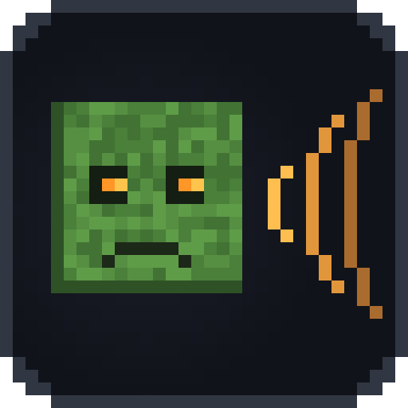
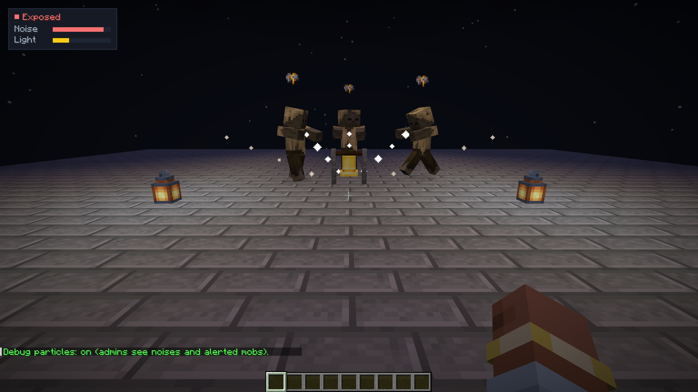
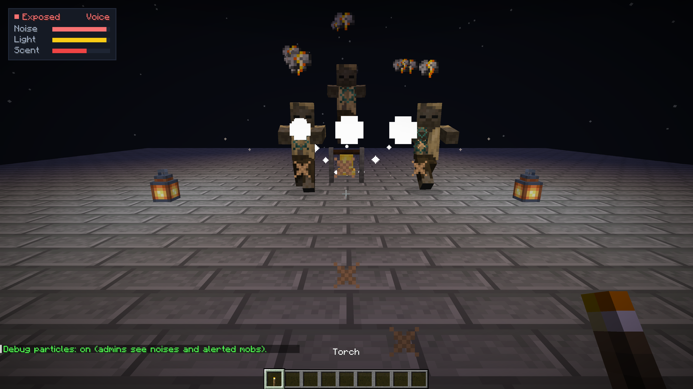
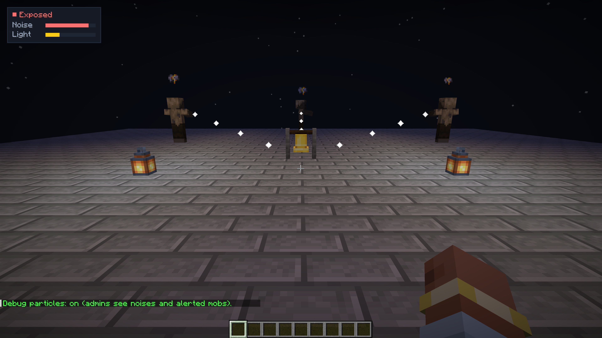
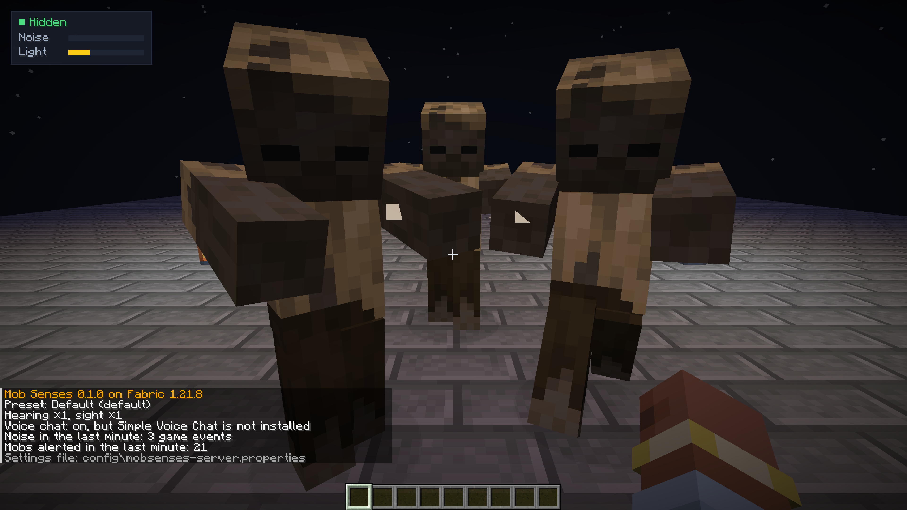

<h1 align="center">Mob Senses</h1>

Mobs hear you, see your light, smell blood trails and, with Simple Voice Chat, hear your voice. A server-side survival and stealth mod for Fabric, Quilt, Forge, NeoForge and Paper.

Hostile mobs in vanilla notice you only within a fixed range. With **Mob Senses** they use their senses:

- **Hearing.** Running is loud, sneaking is quiet, wool muffles your steps and gravel gives you away. Breaking and placing blocks, doors, chests, fights, arrows, explosions, bells, note blocks and eating make noise too. A mob that hears it walks to **where the noise came from**, looks around and goes back to its business. Stone walls muffle noise, glass and wood less, an open door lets it through.
- **Voice** (with [Simple Voice Chat](https://modrinth.com/plugin/simple-voice-chat)). Mobs hear you talk. A shout carries far, a whisper only next to them; loudness is measured against each player's own normal voice, so a quiet microphone gives no free stealth.
- **Light and stealth.** A torch or lantern in your hand makes you visible from afar; darkness and sneaking hide you.
- **Scent.** A badly wounded player (at or below half health) leaves a blood trail that zombies and spiders follow.
- **Stealth HUD.** Players who install the mod on the client see a compact indicator of their noise, light exposure, voice activity and blood scent.

Works like Zombie Awareness, for Minecraft **1.16.5 – 26.3** across **Fabric, Quilt, Forge, NeoForge, Paper, Purpur, Folia and Spigot**, with wall occlusion and voice chat built in.

## Quick start

**Server**
1. Fabric, Quilt, Forge or NeoForge: put the mod's `.jar` into `mods/` (on Fabric and Quilt also [Fabric API](https://modrinth.com/mod/fabric-api)). Paper, Purpur, Folia or Spigot: put `mob-senses-bukkit-*.jar` into `plugins/`.
2. Start the server. Players join with any client, vanilla too: they need nothing.
3. Choose how keen the senses are with `/mobsenses preset subtle|default|hardcore`, or in `mobsenses-server.properties`.

**Singleplayer:** put the same `.jar` into `.minecraft/mods/`.

[Simple Voice Chat](https://modrinth.com/plugin/simple-voice-chat) is optional: without it everything but the voice works.

## What works where

| | Server with the mod | Server without the mod |
|---|---|---|
| **Player without the mod** (vanilla client) | Everything: mobs hear, see and smell | Vanilla |
| **Player with the mod** | Everything, plus the noise and stealth HUD | Vanilla, plus the client noise and light HUD |
| **Singleplayer** | Everything | — |

## Versions and files

| You run | Minecraft | File |
|---|---|---|
| **Fabric, Quilt** | 1.16.5 – 1.21.11, 26.1 – 26.3 | `mob-senses-fabric-…+mc1.16.5-26.x.jar` + [Fabric API](https://modrinth.com/mod/fabric-api) |
| **Forge** | 1.16.5 – 1.21.11, 26.1 – 26.3 | `mob-senses-forge-neoforge-…+mc1.16.5-26.x.jar` |
| **NeoForge** | 1.20.1 – 1.21.11, 26.1 – 26.3 | the same file |
| **Paper, Purpur, Folia, Spigot** | 1.16.5 – 26.3 | `mob-senses-bukkit-….jar` |

One file serves every Minecraft version of its loader: it picks the right code when the game starts.

## Commands

`/mobsenses` is for operators (level 2) and the console. On Paper the permission is `mobsenses.admin`. Replies come in the player's language (English, Russian, Ukrainian, German, Spanish, Portuguese, Chinese).

| Command | What it does |
|---|---|
| `/mobsenses` or `/mobsenses status` | Version, preset, multipliers, voice chat, how much noise the server heard and how many mobs reacted in the last minute |
| `/mobsenses preset <off\|subtle\|default\|hardcore>` | How keen the senses are; `off` makes mobs behave as in vanilla |
| `/mobsenses hearing <0-3>` | How far mobs hear, times the preset |
| `/mobsenses sight <0-3>` | How far mobs see you, times the preset |
| `/mobsenses voice <on\|off>` | Whether mobs hear Simple Voice Chat |
| `/mobsenses debug [on\|off]` | Particle traces for operators showing sound, light and scent paths |
| `/mobsenses world <world\|here> <preset\|inherit>` | A world's own preset (`inherit`: back to the server's) |
| `/mobsenses reload` | Read the settings file again |
| `/mobsenses help` | The list of commands |

| Preset | Hearing | Sight | For |
|---|---|---|---|
| Off | — | — | Vanilla mobs |
| Subtle | ×0.6 | ×0.8 | Builders' servers: mobs notice only real noise |
| Default | ×1 | ×1 | Survival |
| Hardcore | ×1.6 | ×1.3 | Horror and hardcore: every step counts |

## Compatibility

- **Vanilla clients** join a server with the mod; the mod does not change the network protocol.
- **Custom and modded mobs:** the `#mobsenses:listeners` entity type tag controls which mobs investigate noise.
- **Other AI mods** (In Control!, Enhanced AI, Improved Mobs): Mob Senses adds a low-priority investigation goal that yields immediately when a mob enters combat.
- **Simple Voice Chat**: optional; without it everything but the voice works.

---

<b>🇷🇺 Русский</b>

В обычном Minecraft враждебные мобы замечают вас только на фиксированном расстоянии. С **Mob Senses** у них появляются чувства:

- **Слух.** Бег громкий, шаг в приседе тихий, шерсть глушит шаги, а гравий выдаёт. Ломание и установка блоков, двери, сундуки, бой, стрелы, взрывы, колокола, нотные блоки и еда тоже шумят. Моб, который это услышал, идёт туда, **откуда шёл звук**, осматривается и возвращается к своим делам. Каменные стены глушат шум сильнее, стекло и дерево — слабее, открытая дверь пропускает.
- **Голос** (с [Simple Voice Chat](https://modrinth.com/plugin/simple-voice-chat)). Мобы слышат, как вы говорите. Крик разносится далеко, шёпот — только рядом; громкость отсчитывается от обычного голоса самого игрока, поэтому тихий микрофон не даёт бесплатной скрытности.
- **Свет и скрытность.** Факел или фонарь в руке делает вас заметным издалека; темнота и присед прячут.
- **Запах.** Сильно раненый игрок (половина здоровья или меньше) оставляет за собой след, по которому идут зомби и пауки.
- **Индикатор скрытности.** У игроков с модом на клиенте есть компактный индикатор собственного шума, заметности на свету, голоса и следа крови.

### Быстрый старт

**Сервер**
1. Fabric, Quilt, Forge или NeoForge: положите `.jar` мода в `mods/` (на Fabric и Quilt — ещё [Fabric API](https://modrinth.com/mod/fabric-api)). Paper, Purpur, Folia или Spigot: положите `mob-senses-bukkit-*.jar` в `plugins/`.
2. Запустите сервер. Игроки заходят с любым клиентом, в том числе с чистым: им ничего ставить не нужно.
3. Выберите чуткость мобов командой `/mobsenses preset subtle|default|hardcore` или в `mobsenses-server.properties`.

**Одиночная игра:** положите тот же `.jar` в `.minecraft/mods/`.

[Simple Voice Chat](https://modrinth.com/plugin/simple-voice-chat) не обязателен: без него работает всё, кроме реакции на голос.

### Что где работает

| | Сервер с модом | Сервер без мода |
|---|---|---|
| **Игрок без мода** (чистый клиент) | Всё: мобы слышат, видят и чуют след | Обычный Minecraft |
| **Игрок с модом** | Всё, плюс индикатор шума и скрытности | Обычный Minecraft, плюс клиентский индикатор шума и света |
| **Одиночная игра** | Всё | — |

### Версии и файлы

| У вас | Minecraft | Файл |
|---|---|---|
| **Fabric, Quilt** | 1.16.5 – 1.21.11, 26.1 – 26.3 | `mob-senses-fabric-…+mc1.16.5-26.x.jar` + [Fabric API](https://modrinth.com/mod/fabric-api) |
| **Forge** | 1.16.5 – 1.21.11, 26.1 – 26.3 | `mob-senses-forge-neoforge-…+mc1.16.5-26.x.jar` |
| **NeoForge** | 1.20.1 – 1.21.11, 26.1 – 26.3 | тот же файл |
| **Paper, Purpur, Folia, Spigot** | 1.16.5 – 26.3 | `mob-senses-bukkit-….jar` |

Один файл подходит ко всем версиям Minecraft своего загрузчика: нужный код он выбирает сам при запуске.

### Команды

`/mobsenses` доступна операторам (уровень 2) и консоли. На Paper право называется `mobsenses.admin`. Ответы приходят на языке игрока (русский, украинский, английский, немецкий, испанский, португальский, китайский).

| Команда | Что делает |
|---|---|
| `/mobsenses` или `/mobsenses status` | Версия, режим, множители, голосовой чат, сколько шума услышал сервер и сколько мобов отреагировало за последнюю минуту |
| `/mobsenses preset <off\|subtle\|default\|hardcore>` | Насколько чутки мобы; `off` возвращает обычное поведение |
| `/mobsenses hearing <0-3>` | Как далеко мобы слышат, поверх режима |
| `/mobsenses sight <0-3>` | Как далеко мобы видят, поверх режима |
| `/mobsenses voice <on\|off>` | Слышат ли мобы Simple Voice Chat |
| `/mobsenses debug [on\|off]` | Частицы отладки для операторов: пути звука, света и запаха |
| `/mobsenses world <мир\|here> <режим\|inherit>` | Свой режим для отдельного мира (`inherit` — вернуть общий) |
| `/mobsenses reload` | Перечитать файл настроек |
| `/mobsenses help` | Список команд |

---

<a href="https://github.com/Shamanalle/mob-senses/issues">Issues</a> ·
<a href="https://github.com/Shamanalle/mob-senses">Source</a> ·
<a href="https://github.com/Shamanalle/mob-senses/blob/main/LICENSE">License: MIT</a>

